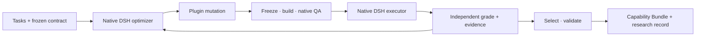

# Let the Harness Evolve

[中文](README.md) · [Project blueprint](11.md) · [Components](docs/components.md) · [Experiments](docs/acceptance-continuous.md) · [Contributing](CONTRIBUTING.md)

[](https://github.com/OLDyade/spark-harness-evolution/actions/workflows/verify.yml)
[Apache-2.0](LICENSE) · DSH `0.2.1-rc.4` · Native Cordis plugins

## Evolve the Harness, Not the Model.

Keep model weights fixed. Let the harness evolve through real tasks.

A plugin-based harness evolution framework: agents use task feedback to reshape their capability structure and turn useful improvements into reusable plugins.

## Three core designs

| Design | What it means |
|---|---|
| **Plugins are the units of evolution** | Configuration, implementation and composition can change together. Enable, disable, tune, replace, compose and create plugins. |
| **Evolution is itself a plugin capability** | Add an Evolution Preset, research method and experiment tools to native DeepSeek Harness. DSH owns the agent loop. |
| **Evolution produces installable capabilities** | Export the exact tested Bundle alongside its ancestry, build identity, evidence and research record. |



The optimizer chooses mechanisms from original inputs, traces, deliveries and independent feedback. The experiment service enforces fixed models, data permissions, budgets and selection. It does not contain task-answer patches or a prescribed list of successful mutations. Business spreadsheets are the first domain; task and evaluator adapters remain separate from the engine.

## Run a real spreadsheet evolution

Use Node **24.16.0**, npm **12.2.0**, pnpm **12.15.0**, Docker and a working model credential. The supplied provider configuration uses Venus `deepseek/deepseek-v4.1-flash-1017`; other models require explicit native DSH Provider configuration. No automatic model substitution occurs.

```bash
npm ci
npm run check
docker build -t harness-evolution:local .
docker build --build-arg HARNESS_IMAGE=harness-evolution:local \
  -f examples/spreadsheet/Dockerfile -t harness-evolution-spreadsheet:local .

mkdir -p .evolution/business
node examples/isolation.mjs runc > .evolution/business/isolation.json
docker run --rm \
  --user "$(id -u):$(id -g)" \
  --mount type=bind,src="$PWD/examples/spreadsheet",dst=/example,readonly \
  --mount type=bind,src="$PWD/.evolution/business",dst=/workspace \
  harness-evolution-spreadsheet:local python3 /example/generate.py /workspace/dataset

node examples/spreadsheet/prepare.mjs .evolution/business/dataset \
  "$(docker image inspect harness-evolution-spreadsheet:local --format '{{.Id}}')" \
  examples/venus/model.json .evolution/business/spec.json .evolution/business/isolation.json

node dist/cli.js init --root .evolution/business/search \
  --spec .evolution/business/spec.json --dataset .evolution/business/dataset \
  --seed examples/spreadsheet/seed
```

Before `init`, inspect the generated contract. It freezes the task manifest, model configuration, budgets, resource limits and runtime. `candidate.qa: null` means no additional domain command; native full-composition QA always runs. Explicit outcome constraints are optional declarations; an empty `constraints` array leaves auxiliary metrics report-only.

Store `VENUS_API_KEY` in a private environment file outside the repository, with permissions `0600`. Start one coordinator:

```bash
node --env-file=/absolute/private/venus.env dist/cli.js evolve \
  --root .evolution/business/search --host 0.0.0.0 --port 18948 \
  --endpoint http://host.docker.internal:18948

node dist/cli.js status --root .evolution/business/search
```

The container endpoint must reach the chosen host interface. `host.docker.internal` is available in the documented macOS Docker Desktop / OrbStack setup; configure an explicit reachable interface and firewall on Linux. The control API uses a per-experiment capability token. Select an installed runtime explicitly: [isolation contracts and gVisor acceptance](docs/isolation.md).

The example creates public synthetic XLSX tasks and grades actual files through independent LibreOffice recalculation. It is an engineering experience. For research, `research.py` supplies four business-mechanism task families; preregister task roles, repetitions and budgets before execution. See the [concrete joint-plugin study registration](docs/experiments/2026-10-27-joint-plugin-development.json). Private historical benchmarks and answers are excluded from this repository.

## Evidence you can inspect

The latest [preregistered development study](docs/acceptance-joint-development.md) improved the mean from 65.625% to 81.25%, with 24 scored executions, one retained native QA failure and 326 adapter calls. Its selected candidate introduced heuristic source restoration and is **not accepted for capability distribution**. This development result does not establish stable gains.

Use `node dist/cli.js report --root <experiment> --output <new-report.json>` to aggregate scores, failures, executor usage and optimizer expenditure without rerunning tasks.


This figure is generated from the [machine-readable record](docs/evidence/2026-10-27-continuous-acceptance.json). Three real mutations were evaluated. Validation selected Mutation 1 by highest search score, breaking ties by earliest ordinal; it retained one transport failure and two cancellations in the full denominator. Stable quality gains have not been established. These are synthetic business tasks, not official SpreadsheetBench scores.

Read the [full experiment report](docs/acceptance-continuous.md) for individual scores, implementation changes, usage and limitations. Recreate the figure with `python3 scripts/render-evidence.py`; plotting dependencies are pinned in `scripts/requirements-figures.txt`.

| Layer | Verified behavior |
|---|---|
| Native composition | Profile + environment + candidate patch; service dependencies, Presets and tool schemas |
| Build identity | Locked installation, compilation, bundled dependencies; identical artifact for QA, execution, validation and export |
| Recovery | Persistent event cursors and single-writer lease; collect original containers after coordinator interruption |
| Independent grading | Private evaluator mounts, complete denominators, declared outcome constraints and preserved failures |
| Isolation | Explicit non-root/resource/network contracts; runc and pinned gVisor acceptance |
| Asset reuse | Authorized library search, exact source inspection and import provenance; previous scores never transfer |

Current GitHub Actions include macOS/Ubuntu checks and runc/gVisor jobs. Account billing limits have prevented cloud jobs from starting; local evidence is reported separately. See [delivery status](docs/completion.md) for the remaining full-project work.

## Install the evolved capability

To use an installed capability directly, follow the [native headless task guide](docs/use-capability.md). A clean-container acceptance installed a real evolved tarball with `dsh plugin add` and completed a real model task; no optimizer or evaluator was needed. The guide includes input mounts, credentials, native session records and actual delivery checks.

Export a frozen candidate by its digest:

```bash
node dist/cli.js export --root .evolution/business/search \
  --candidate <digest> --output /absolute/new-export-directory
dsh plugin --profile sdk add /absolute/new-export-directory/bundle.tgz
```

Independent validation uses the same frozen build artifacts under a preregistered comparison contract. Validation exposes no optimizer API; a search champion is not automatically published. See [research protocol](docs/research-protocol.md).

The evolution machinery is also a native Bundle. Run `npm pack`, install it into the target DSH Profile, configure `EVOLUTION_ENDPOINT` and `EVOLUTION_TOKEN`, and select **Harness Evolution**. The coordinator command handles this assembly automatically; explicit SDK embedding follows the [Preset integration guide](docs/presets.md). Research methods are independently versioned Bundles.

## Extend and reproduce

| Goal | Entry |
|---|---|
| Understand the system | [Component map and lifecycle](docs/components.md), [architecture](docs/architecture.md) |
| Add a domain | [Task, delivery and evaluator contract](docs/domain-adapters.md) |
| Choose outcome constraints | [Independent observations and exact threshold comparison](docs/constraints.md) |
| Reuse research | [Authorized assets and provenance](docs/research-assets.md) |
| Resume experiments | [Events and replay](docs/events.md) |
| Check supported versions | [Compatibility](docs/compatibility.md) |
| Contribute or report a vulnerability | [Contributing](CONTRIBUTING.md), [security](SECURITY.md) |

```bash
HE_TEST_RUNTIME=runc \
HE_TEST_IMAGE=$(docker image inspect harness-evolution:local --format '{{.Id}}') \
  npm run test:container
npm run test:install
npm audit --audit-level=moderate
```

Built on [DeepSeek Harness](https://github.com/deepseek-ai/deepseek-harness) and its Cordis ecosystem. Related research and source-pinned technical decisions are recorded in [research notes](docs/research/2026-10-27-harness-evolution-design-review.md). Licensed under [Apache-2.0](LICENSE); see [NOTICE](NOTICE) and [CITATION.cff](CITATION.cff). The repository remains private until an explicit publication decision.
