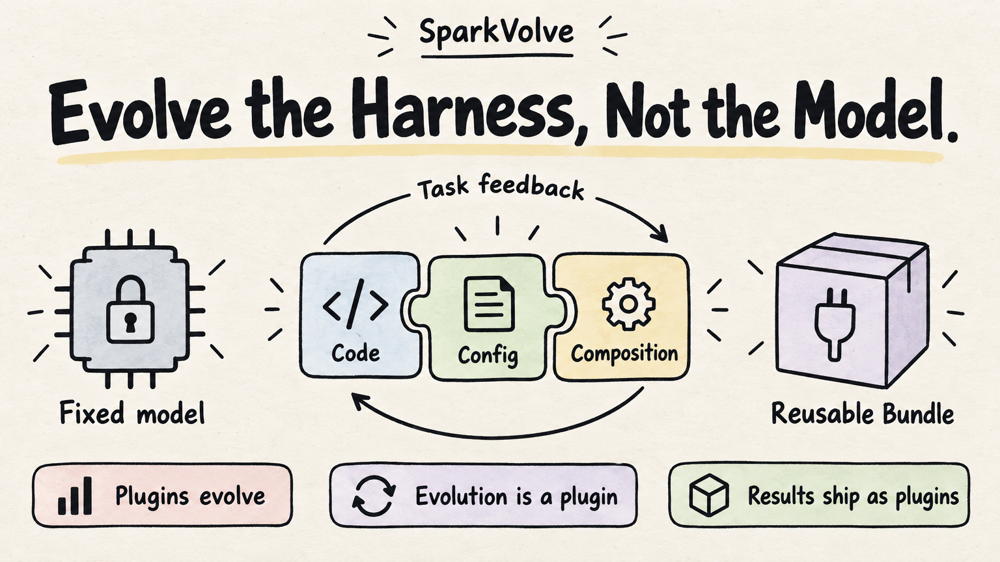
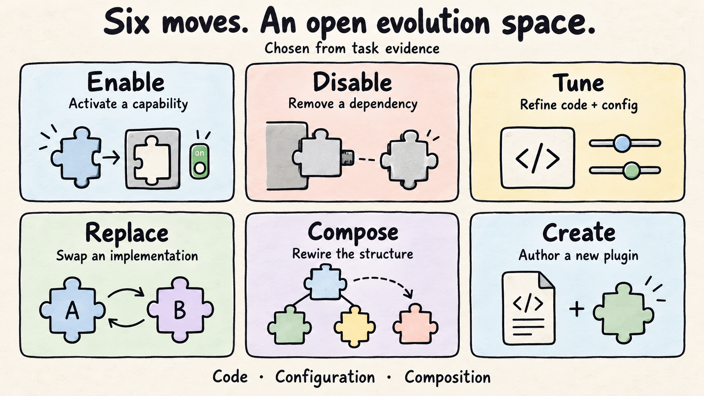
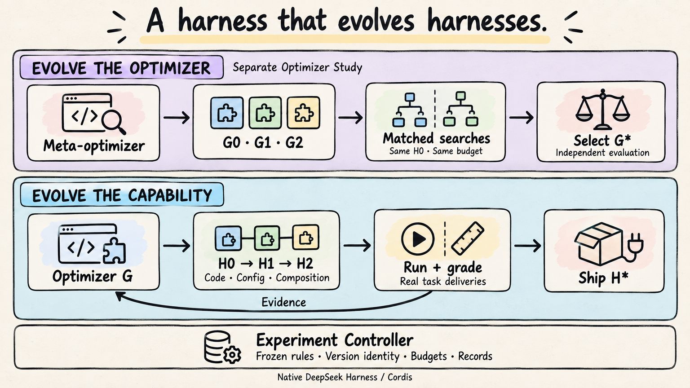
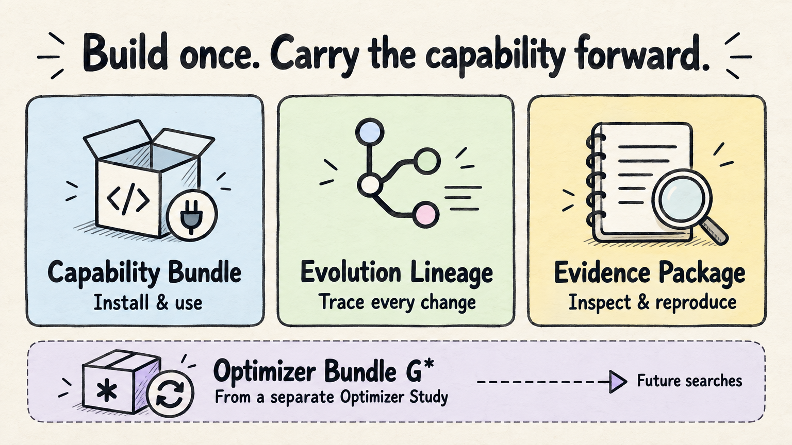
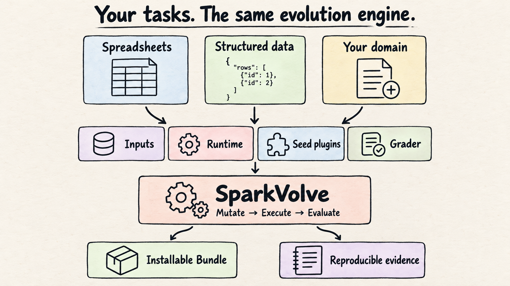

<div align="center">


# SparkVolve

**Evolve the Harness, Not the Model.**

Keep model weights fixed. Let the harness evolve through real tasks.

**Evolve capabilities. Evolve the way they evolve. Ship both as plugins.**

> 🏆 **BIRD Mini-Dev 2026 · all 500 official tasks · EX 91.0% (455/500)** — same model, zero weight updates, a self-evolved harness.

[](https://github.com/OLDyade/SparkVolve/actions/workflows/verify.yml) [](LICENSE) [](docs/components.md)

[English](README.md) · [中文](README.zh-CN.md) · **[Live tour ↗](https://oldyade.github.io/SparkVolve/)** · [Quick start](#quick-start) · [Blueprint](11.md)

</div>

A plugin-based harness evolution framework: agents use real task feedback to reshape their capability structure and turn useful improvements into reusable plugins.

> We used to equip agents with capabilities. Now agents can decide which capabilities they need, which to change, and which to create.



## 🧬 Three core designs

| Plugins are the genes of evolution | Evolution is a plugin | Evolution results are plugins |
|:---|:---|:---|
| **From manual assembly to autonomous restructuring.** Evolve plugin code, configuration and composition together. | **Equip an existing harness with the ability to evolve.** Research, coding and experiments run inside native DSH / Cordis. | **From benchmark scores to installable capabilities.** Carry improvements forward with Bundles, lineage and reproducible evidence. |

**Enable · Disable · Tune · Replace · Compose · Create**



## 🔁 A harness that evolves harnesses

**The executor can evolve its capabilities. The optimizer can evolve its own approach.**



| Evolution target | What can change | What decides |
|:---|:---|:---|
| **H · Executor Harness** | Business tools, plugin code, configuration and assembly | Independently graded task deliveries |
| **G · Optimizer Harness** | How it investigates, develops plugins and conducts experiments | The H candidates it produces from the same H0 under matched budget caps |

**Discover → Adapt / Author → Compose → Evaluate → Ship**

| 🔎 Discover | 🧩 Compose | 📦 Ship |
|:---|:---|:---|
| Official DSH, community markets, local Bundles and research assets | Exact dependencies, native Bundle layers and observed Cordis service bindings | The evaluated package, its real ancestry and independently checked delivery |

The optimizer chooses what to reuse, change or create. A frozen capability catalog keeps those choices reproducible; native resolution turns them into editable candidates. [Explore Capability Evolution →](docs/capability-evolution.md)

Both run on **DeepSeek Harness / Cordis**. The Controller owns experiment rules, version identity, budgets and records; the Grader evaluates deliveries. Optimizer evolution runs as a separate **Optimizer Study**.

[Native plugin authoring](docs/native-authoring.md) · [Behavioral probes](docs/behavioral-probes.md) · [Optimizer Studies](docs/optimizer-studies.md) · [Architecture](docs/architecture.md)

## 📦 Take the capability with you

**Install it. Inspect its history. Run it on your tasks.**



| Deliverable | Inside | Put it to work |
|:---|:---|:---|
| **Capability Bundle · H\*** | Original `bundle.tgz`, source, assembly and capability card | [Install into a fresh DSH Profile](docs/use-capability.md) |
| **Evolution Lineage** | Candidate ancestry, source diffs, proposals and selection decisions | [Inspect a real mutation](docs/experiments/anatomy-of-a-mutation.md) |
| **Evidence Package** | Scores, failures, usage, trace inventories and independent validation | [Audit and reproduce](docs/experiments/README.md) |
| **Optimizer Bundle · G\*** | Selected optimizer source and frozen artifact, from a **separate study** | [Reuse an optimization method](docs/optimizer-studies.md) |

Installed capabilities run in the native Agent Loop. Using them does not require running the evolution process again.

<a id="quick-start"></a>

## 🚀 Start evolving

| Explore an experiment | Run your own |
|:---|:---|
| **[Open the live tour ↗](https://oldyade.github.io/SparkVolve/)** — source diffs, task results and downloadable records. No setup or API calls. | **[Prepare your environment](docs/quick-start.md#preparation)** — clone the repo; Node.js 24, Python 3, Docker, an official DeepSeek key and a reserved private network pool. |

```bash
npm ci
npm start -- --env-file /absolute/private/deepseek.env
```

**One entry: autonomous development → independent validation → original-package installation → fresh reuse.** Defaults: official DeepSeek, a **36-task SpreadsheetBench 2 panel**, **900 seconds per task**. Keep credentials outside the repository. First launch builds images; model calls use your provider quota.

**Bring your domain:** 🗂 Tasks + ⚙️ Runtime + 🧩 Seed plugins + ⚖️ Grader.



Use `--benchmark` to select a community benchmark adapter. The [SpreadsheetBench 2 track](benchmarks/spreadsheetbench2/README.md) connects official inputs and scoring to the same native DSH / Cordis engine.

[Full quick start](docs/quick-start.md) · [Add a domain](docs/domain-adapters.md) · [Install a capability](docs/use-capability.md)

## 📊 Results: BIRD Mini-Dev 2026

**Same model, zero weight updates. Text-to-SQL capability evolved by the harness itself.**

| Version | Evaluation | SQLite EX |
|:---|:---|:---:|
| Start H0 · interactive agent | Development | 76.1% |
| **Evolved champion H49** | **Development · 300 tasks** | **91.67% (275/300)** |
| **Evolved champion H49** | **Validation · 100 tasks (never used in evolution)** | **89% (89/100)** |
| **Evolved champion H49** | **Test · 100 tasks (never used in evolution)** | **91% (91/100)** |
| **Evolved champion H49** | **All 500 official tasks** | **91.0% (455/500)** |

The official 500 tasks are split 300 development / 100 validation / 100 test. Scores agree across all three splits: the 200 tasks never used in evolution also hold at the 90% level.

- 🧬 **58 candidates, 9 champion jumps** — real parent lineage for every generation; regressions published too.
- 🔁 **The optimizer evolves as well** — G rewrote itself 20 times; 17 versions loaded natively and drove the search.
- 🔍 **Readable gains** — the champion evolved 23 SQL reasoning rules (build the cohort before the ratio, negation silently drops NULLs, the noun "latest" binds to decides what gets ranked). No task-specific hacks.
- ⚙️ Fixed DeepSeek V4 Flash, 300 s per task, the official `calculate_ex` grader executed unchanged.

> For reference, on the official fixed-prompt table (single generation, no database access) DeepSeek V4.1-Flash scores 61.0% and Claude Opus 5.5 90.0%. SparkVolve runs as an interactive agent with database access.

**[BIRD track →](benchmarks/bird/README.md)** · Data: [`birdsql/bird_mini_dev`](https://huggingface.co/datasets/birdsql/bird_mini_dev) (CC BY-SA 4.0)

<details>
<summary><strong>More experiments: SpreadsheetBench 2 and the early research ledger</strong></summary>


**SpreadsheetBench 2 · Debugging + Financial Modeling + Templates**

| Develop | Validate | Test & reuse |
|:---:|:---:|:---:|
| **12 tasks** · fixed 4-task screen | **10 tasks** · frozen candidates | **14 tasks** · original packages |
| Task feedback drives evolution | Same tasks compare all three arms | Workbook families kept separate |

`Prompt only` · `Single-plugin code` · `Open plugin evolution`

Same H0, model, tasks and budget. The optimizer chooses its ancestry and whether to discover, reuse, adapt or author. The official evaluator stays unchanged. No required mutation checklist.

**[Run the community benchmark →](benchmarks/spreadsheetbench2/README.md)** · [Registered task panel](benchmarks/spreadsheetbench2/mixed36.json)

Community benchmark results will be reported with failures and full denominators. Earlier synthetic runs remain in the research ledger as engineering evidence.

| Record | What it establishes |
|:---|:---|
| [Executor evolution](docs/experiments/2026-10-28-official-deepseek-results.md) | Real plugin implementation changes, independent validation and unchanged-archive reuse. This case did not change plugin topology. |
| [Optimizer evolution](docs/experiments/2026-10-28-optimizer-study-results.md) | G1 was autonomously authored, built and run. It tied G0; G0 was retained. Added tools recorded zero native calls. |
| [Mutation-space comparison](docs/experiments/2026-10-29-closure-study-results.md) | Three arms, six searches, twelve patches, 124 task scorings. Five searches retained H0; one candidate passed validation and reuse at 100%. No demonstrated method advantage. |
| [One-command startup](docs/experiments/2026-10-29-official-closure-results.md) | Structured-data search, independent validation and original-package reuse completed; H0 was retained. |

Native dependency composition and real community-package adoption now have behavioral acceptance, including original-package reuse. Stronger autonomous structural-evolution and quality evidence remain open. [Capability integration](docs/experiments/2026-10-30-capability-evolution.md). [Implementation status](docs/completion.md) · [All experiments](docs/experiments/README.md) · [Research protocol](docs/research-protocol.md)

</details>

## 🧭 Build on SparkVolve

| Understand | Extend | Research | Ship |
|:---|:---|:---|:---|
| [Blueprint](11.md)<br>[Architecture](docs/architecture.md)<br>[Components](docs/components.md) | [User journey](docs/user-journey.md)<br>[Domain adapters](docs/domain-adapters.md)<br>[Compatibility](docs/compatibility.md) | [Experiment protocol](docs/research-protocol.md)<br>[Optimizer Studies](docs/optimizer-studies.md)<br>[Evidence index](docs/experiments/README.md) | [Install Bundles](docs/use-capability.md)<br>[Releasing](docs/releasing.md)<br>[Contributing](CONTRIBUTING.md) |

Bring a new domain, a mutation mechanism or a reproducible failure case. [Contribute](CONTRIBUTING.md) · [Open an issue](https://github.com/OLDyade/SparkVolve/issues) · [Security](SECURITY.md)

---

Built on **DeepSeek Harness / Cordis** native plugins. [Apache-2.0](LICENSE) · [Attribution](NOTICE) · [Citation](CITATION.cff). Development version; registry publication and versioned releases are managed separately.
