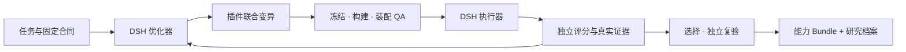
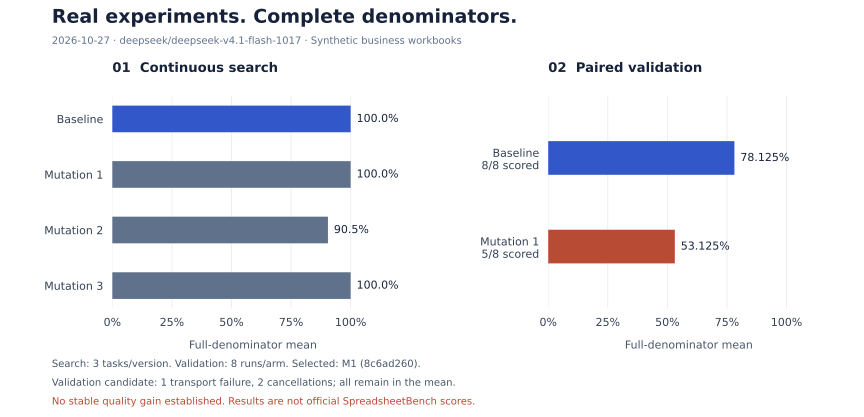

# 让 Harness 自己进化

[English](README.en.md) · [项目全景](11.md) · [组件地图](docs/components.md) · [实验记录](docs/acceptance-continuous.md) · [开发指南](CONTRIBUTING.md)

[](https://github.com/OLDyade/spark-harness-evolution/actions/workflows/verify.yml)
[Apache-2.0](LICENSE) · DSH `0.2.1-rc.4` · Native Cordis plugins

## Evolve the Harness, Not the Model.

不改模型权重，让 Harness 在任务中持续进化。

一个基于插件化架构的 Harness 自进化框架，让 Agent 通过真实任务反馈，自主改造自己的能力结构，并将有效改进沉淀为可复用的插件。

## 三个核心设计

- **插件即进化基因：让 Harness 从“人工装配”走向“自主重构”**
- **进化也是插件：给已有 Harness 装上自进化能力**
- **进化成果也是插件：从实验分数到可安装的能力**

```text
  配置 · 实现 · 组合结构                 真实任务反馈                  可复用的能力
           │                                │                            ▲
           └── 启用 · 停用 · 调优 · 替换 · 组合 · 创造 ── 独立验证 ── Bundle
```

优化器拥有原生 DSH 的研究与编码能力，可以创造插件、重构服务边界、调整装配。实验层固定模型、数据权限、预算和评判规则，让每次改动留下可比较、可追溯的证据。商业 Excel 是首个场景，领域接入通过独立任务与裁判完成。

## 从这里开始

| 文档 | 内容 |
|---|---|
| [项目全景与核心指导](11.md) | 核心思想、开放指导原则、完整 ASCII 流程与后续重构蓝图 |
| [最新深度审校](docs/research/2026-10-27-harness-evolution-design-review.md) | 相关研究、DSH 机制、搜索方法、实验协议与贡献定位 |
| [前期生态审校](docs/research/2026-10-09-harness-blueprint-audit.md) | 历史概念核验与架构推敲 |
| [历史资料与同步记录](docs/research/archive/README.md) | 来源哈希、历史证据和迁移边界 |
| [可执行架构与边界](docs/architecture.md) | 原生插件、控制服务、身份、恢复、隔离与成本 |
| [当前实现核验](docs/research/2026-10-27-native-implementation.md) | 实际发布物、源码差异、原生验证和工程决策 |
| [真实模型端到端验收](docs/acceptance.md) | 自主代码变异、真实评分、失败裁决和原生安装后的实际任务 |
| [连续进化与独立复验](docs/acceptance-continuous.md) | 三次真实变异、双会话接续、负结果与研究资产复用 |
| [全景方案落实状态](docs/completion.md) | 已验证能力、尚缺的完整交付环节与研究边界 |
| [深度评审落实账本](docs/review-ledger.md) | 全部评审项、核实结论、实现与验收进度 |
| [组件与生命周期](docs/components.md) | 原生插件组合、实验服务、候选状态和事件接续图 |

## 它如何运行

```text
任务与实验合同
      │
      ▼
DSH 优化器 ── 真实证据 ──► 改写插件配置 / 实现 / 组合
      ▲                              │
      │                              ▼
      │                    冻结源码 → 构建 Bundle → 独立 QA
      │                              │
      │                              ▼
      │                    DSH 执行器 × 固定任务清单
      │                              │
      └── 评分、轨迹、交付 ◄── 独立评分 / 完整分母
                                     │
                          严格择优 → 独立复验 → 可安装 Bundle
```

优化器沿用 DSH Agent Loop 和编码工具，依据反馈选择改动。控制器只执行实验合同：冻结、调度、记账、评分与选择。框架没有预置题目答案或逐题变异脚本。



## Quick start：真实 Excel 闭环

运行前显式生成[隔离合同](docs/isolation.md)：五类角色使用声明的运行时、非 root 身份和资源预算。原容器恢复时重新核验权限，运行时缺失直接报错。

支持显式选择 runc 或 gVisor；gVisor 已完成插件构建、原生 DSH 执行、独立评分、恢复及真实模型接续验收。[固定版本安装与测试矩阵](docs/isolation.md)提供可复现入口。

需要 Node **24.16.0**、npm **12.2.0**、pnpm **12.15.0** 和运行中的 Docker。示例采用用户指定的 Venus 模型快照；其他模型通过原生 DSH Provider 配置接入。没有自动模型降级。

```bash
npm ci
npm run check
docker build -t harness-evolution:local .
docker build --build-arg HARNESS_IMAGE=harness-evolution:local \
  -f examples/spreadsheet/Dockerfile -t harness-evolution-spreadsheet:local .

mkdir -p .evolution/business
node examples/isolation.mjs runc > .evolution/business/isolation.json
docker run --rm \
  --user "$(id -u):$(id -g)" \
  --mount type=bind,src="$PWD/examples/spreadsheet",dst=/example,readonly \
  --mount type=bind,src="$PWD/.evolution/business",dst=/workspace \
  harness-evolution-spreadsheet:local python3 /example/generate.py /workspace/dataset

node examples/spreadsheet/prepare.mjs .evolution/business/dataset \
  "$(docker image inspect harness-evolution-spreadsheet:local --format '{{.Id}}')" \
  examples/venus/model.json .evolution/business/spec.json .evolution/business/isolation.json

node dist/cli.js init --root .evolution/business/search \
  --spec .evolution/business/spec.json --dataset .evolution/business/dataset \
  --seed examples/spreadsheet/seed
```

将密钥写入仓库外权限为 `0600` 的环境文件，变量名为 `VENUS_API_KEY`。一条命令管理控制服务、执行、评分和优化器会话。端口需空闲，Docker 必须能到达控制服务。macOS Docker Desktop / OrbStack 可通过 `host.docker.internal` 到达宿主；Linux 需明确配置可达接口与防火墙。

```bash
node --env-file=/absolute/private/venus.env dist/cli.js evolve \
  --root .evolution/business/search --host 0.0.0.0 --port 18948 \
  --endpoint http://host.docker.internal:18948

# 查看真实产物与裁决
node dist/cli.js status --root .evolution/business/search
```

示例生成公开合成 XLSX 业务任务，使用真实模型和独立 LibreOffice 重算。它验证产品闭环，不能代表 SpreadsheetBench 分数、迁移收益或统计显著性。历史私有题库、答案和运行产物没有进入仓库。

需要研究实验时，使用 `research.py` 生成四类业务机制任务，在 `init` 前登记任务角色、重复次数、候选与失败预算。全部候选使用同一合同；[已登记的联合插件实验](docs/experiments/2026-10-27-joint-plugin-development.json)提供一份具体示例。工程演示与研究实验分别记账。

## 已经跑通的实验



图表直接生成自[机器记录](docs/evidence/2026-10-27-continuous-acceptance.json)，包含三次真实变异及新任务配对执行。复验选择搜索最高分且同分最早的 Mutation 1；该候选在复验中发生一次传输故障和两次取消，保留完整分母。当前证据尚未证明稳定提分。逐题结果、源码变化、用量和边界见[完整实验报告](docs/acceptance-continuous.md)。

原生插件装配、构建产物一致性、事件接续、研究资产复用、独立约束评分及 runc/gVisor 隔离均有专项验收。图表可用 `python3 scripts/render-evidence.py` 从同一记录重新生成；绘图依赖见 `scripts/requirements-figures.txt`。

## 复验与安装

从 `status` 取得冻结候选 digest。[独立复验指南](docs/research-protocol.md)用同一预注册协议运行基线与候选，记录逐题、重复和配对差异；validation 不开放优化器 API。发布决策由研究证据支持，搜索冠军不会自动变成公开版本。

```bash
node dist/cli.js export --root .evolution/business/search \
  --candidate <digest> --output /absolute/new-export-directory

# 导出的 capability Bundle 可直接装入 DSH 的目标 Profile
dsh plugin --profile sdk add /absolute/new-export-directory/bundle.tgz
```

进化设施自身同样可安装：`npm pack` 后通过原生命令装入目标 Profile，设置 `EVOLUTION_ENDPOINT` 与 `EVOLUTION_TOKEN`，再选择 **Harness Evolution** Preset。十项进化工具和研究方法只对选择该组合的会话可见。`evolve` 自动完成装配；独立使用 `sdk/sdk-minimal` 时，需加载[原生注册表与选择桥配置](docs/presets.md#sdk-的明确接入)。方法 Bundle 可单独替换，内容哈希写入实验合同。

提交候选后，优化器通过 `evolution_wait` 等待已提交事件。持久游标支持断线补读，控制器恢复时收集原容器；无须反复空查，也不会因等待超时重跑任务。[事件与恢复协议](docs/events.md)

研究资产也进入进化循环：研究者在合同中授权一个冻结库，优化器即可检索历史机制与负结果、检查原始源码，自主导入并改造。来源随候选保存，旧成绩不进入新实验裁决。[资产复用与授权](docs/research-assets.md)

研究资产支持 `remember → library → import`：保留有效候选与负结果、谱系、来源、账本和证据哈希。导入产生新的可编辑草稿，历史分数不会转移到新实验。详见[架构](docs/architecture.md)。

## 可靠性与证据

- 状态机与单写租约，唯一任务身份，断点接回原容器。
- 候选 lock 与构建镜像固定；QA、执行、复验和分发使用同一冻结构建产物，源码单独保留供继续变异。
- 固定题集、完整分母、独立评分；同分拒绝，失败与负结果保留。
- 评分故障可以对同一冻结交付 `rescore`；不会重做任务刷分。
- 原生请求账本区分成功、失败、未完成与缺失用量，优化器和执行器分别记账。
- 类型检查、原生 SDK 子进程、容器执行、独立评分、恢复与安装分别验收。

| 验证层 | 检查内容 | 证据 |
|---|---|---|
| 合同与状态 | 冻结身份、完整分母、约束、租约、重放 | `npm run check` |
| 原生 DSH | Profile / Preset / 服务依赖 / Schema / 会话作用域 | [组件](docs/components.md)、[Preset](docs/presets.md) |
| 真实容器 | 构建、执行、故障恢复、私有评分、分发；runc 与 gVisor | [隔离验收](docs/isolation.md) |
| 真实模型 | 自主变异、连续搜索、独立复验、失败和用量 | [实验报告](docs/acceptance-continuous.md) |
| GitHub Actions | macOS / Ubuntu 检查与双运行时矩阵 | [当前工程状态](docs/completion.md) |

Actions 徽章显示真实远端状态。当前云端运行曾因账户账单/额度限制无法启动；本地通过记录单独保留。完整交付范围及尚未完成项见[落实状态](docs/completion.md)。

```bash
HE_TEST_RUNTIME=runc HE_TEST_IMAGE=$(docker image inspect harness-evolution:local --format '{{.Id}}') npm run test:container
npm audit --audit-level=moderate
```

当前能力和未验证边界明确记录于[架构](docs/architecture.md)与[安全说明](SECURITY.md)。参与开发见 [CONTRIBUTING.md](CONTRIBUTING.md)，接入新任务见[领域适配](docs/domain-adapters.md)，运行版本见[兼容性](docs/compatibility.md)。

采用 [Apache-2.0](LICENSE)，引用信息见 [CITATION.cff](CITATION.cff)，第三方归属见 [NOTICE](NOTICE)。仓库当前保持私有；许可证选择不代表已经公开发布。

通用框架优先，商业 Excel 是首个场景。架构承接 DeepSeek Harness / Cordis 原生插件生态，研究归属与引用见调研文档。
