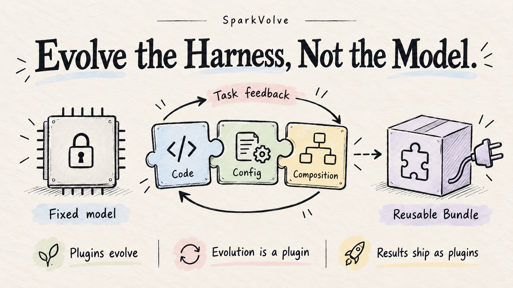
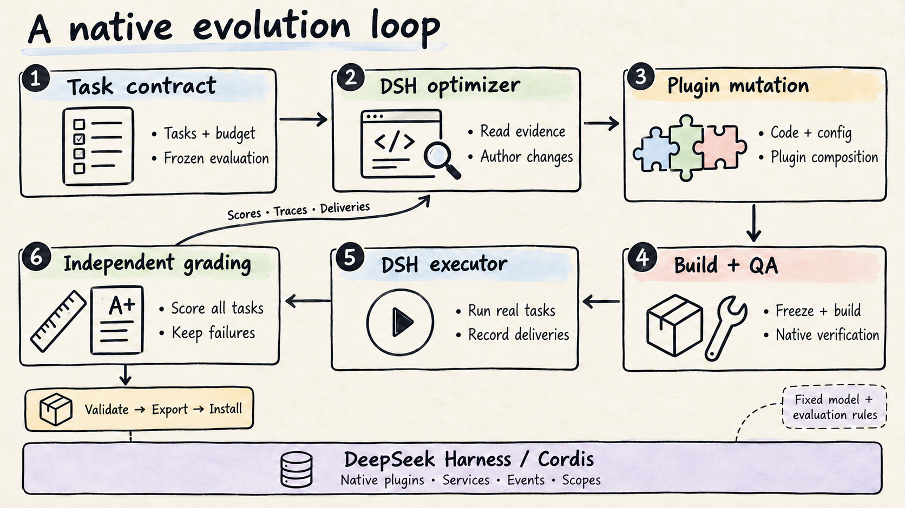
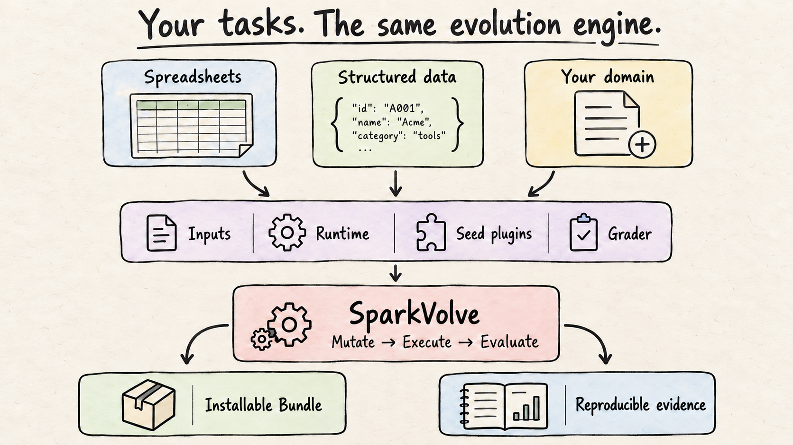

<div align="center">

# Let the Harness Evolve

**Evolve the Harness, Not the Model.**

Keep model weights fixed. Let the harness evolve through real tasks.

[](https://github.com/OLDyade/spark-harness-evolution/actions/workflows/verify.yml)
[](LICENSE)
[](docs/components.md)

[English](README.md) · [中文](README.zh-CN.md) · [Quick start](#quick-start) · [How it works](#how-it-works) · [Bring your tasks](#bring-your-tasks) · [Blueprint](11.md)



</div>

A plugin-based harness evolution framework: agents use real task feedback to reshape their capability structure and turn useful improvements into reusable plugins.

> We used to equip agents with capabilities. Now agents can decide which capabilities they need, which to change, and which to create.

## Three core designs

**Plugins are the genes of evolution: from manual assembly to autonomous restructuring.**<br>
Configuration, implementation and composition belong to one evolution space. Agents can enable, disable, tune, replace, compose and author plugins.

**Evolution is a plugin: equip an existing harness with the ability to evolve.**<br>
An Evolution Bundle and Preset bring research, coding and experimentation into the native DeepSeek Harness / Cordis ecosystem.

**Evolution results are plugins: from benchmark scores to installable capabilities.**<br>
Ship improvements with the original Bundle, candidate lineage, capability card and reproducible experiments.

## Quick start

**Run real evolution:** clone the repository and prepare Node.js 24, Python 3, Docker and an official DeepSeek key. Set `HE_EGRESS_POOL` to a reserved private subnet and keep credentials in an environment file outside the repository; see the [startup guide](docs/quick-start.md).

```bash
npm ci
npm start -- --env-file /absolute/private/deepseek.env --pool "$HE_EGRESS_POOL"
```

The entry builds the environment, generates sample tasks, starts the native DSH optimizer, independently grades executions and exports the selected Bundle. Defaults: official DeepSeek, a structured-data example and **600 seconds per task**. Replace tasks and the seed plugin with `--recipe`; Excel is an optional example. Model, tasks, budgets and concurrency enter a frozen contract.

**Explore existing evidence:** open the [interactive experiment tour](docs/tour.html) to inspect candidates, task-level results and downloadable records offline. No API key needed.

| Your goal | Start here |
|:---|:---|
| Complete an evolution run | [Environment and startup](docs/quick-start.md) |
| Use your own tasks | [Domain adapter interface](docs/domain-adapters.md) |
| Use an evolved capability | [Install a capability Bundle](docs/use-capability.md) |

## How it works



**The optimizer chooses what to change. The experiment system keeps comparisons grounded.**<br>
A native DSH optimizer reads tasks, traces and deliveries, investigates causes and writes code. The controller freezes versions, enforces budgets, schedules work and records usage. An independent grader evaluates actual deliveries against fixed rules.

| Mutation | Evolution surface |
|:---|:---|
| **Enable / Disable** | Capabilities, dependencies and redundant plugins |
| **Tune / Swap** | Configuration, prompts, Skills, tool implementations and interfaces |
| **Compose / Author** | Plugin topology, scopes, event wiring and new capabilities |

Native authoring references, tool contracts and behavioral probes help the optimizer test its hypotheses. Candidates pass build and QA before real tasks. Improvements, regressions, failures and costs remain in the record. Independently validated changes can become installable capabilities.<br>
Explore: [Native authoring](docs/native-authoring.md) · [Behavioral probes](docs/behavioral-probes.md) · [Architecture and recovery](docs/architecture.md)

## Bring your tasks



**A general evolution framework, with tasks you define.** Business spreadsheets are the first example. Structured events and logs already use the same controller through a second domain adapter.

| You provide | Purpose |
|:---|:---|
| **Tasks and inputs** | Goals, files, delivery format and stable task IDs |
| **Runtime** | Model, dependencies and execution image |
| **Seed plugins** | The starting capability, configuration and composition |
| **Independent grader** | Scores and authorized feedback from actual deliveries |

Set budgets and selection rules in the experiment contract, then run the same evolution loop. A new domain requires implementing and validating its adapter.

[Spreadsheet example](examples/spreadsheet) · [Structured-data example](docs/structured-data.md) · **[Build your domain adapter →](docs/domain-adapters.md)**

## Ship capabilities with evidence

Each experiment produces three reusable assets:

| Capability | Process | Evidence |
|:---|:---|:---|
| Frozen native **Bundle** | Source, composition and candidate lineage | Task scores, failures, traces and usage |
| Install into a fresh Profile | Import variants for further evolution | Independent validation and capability cards |

The [official DeepSeek end-to-end experiment](docs/experiments/2026-10-28-official-deepseek-results.md) completed autonomous plugin modification, independent validation and original-package installation:

| Stage | Observed result |
|:---|:---|
| Autonomous development | H0 **56.25%** → H1 **81.25%** → H2 **100%** |
| Independent execution | H0 **81.25%** → H2 **100%** |
| Business tasks after original-archive installation | **4 / 4** synthetic tasks passed |

These are engineering acceptance results on public synthetic tasks. They do not establish stable improvement or cross-domain transfer. Regressions, semantic errors and transport failures remain public in the [experiment index](docs/experiments/README.md).

The latest [mutation-space comparison](docs/experiments/2026-10-29-mutation-space-results.md) completed three arms, six independent searches and 100 task executions. Candidate patches, observed tool calls and counterexamples are public. This study has not established an advantage for unrestricted plugin mutation.

## Explore further

| Direction | Documentation |
|:---|:---|
| **Understand the method** | [Blueprint](11.md) · [Architecture](docs/architecture.md) · [Components](docs/components.md) |
| **Run and extend** | [Full walkthrough](docs/user-journey.md) · [Domain adapters](docs/domain-adapters.md) · [Compatibility](docs/compatibility.md) |
| **Research and reproduce** | [Independent protocols](docs/research-protocol.md) · [Optimizer evolution](docs/optimizer-studies.md) · [Experiments](docs/experiments/README.md) |
| **Ship and contribute** | [Install capabilities](docs/use-capability.md) · [Releasing](docs/releasing.md) · [Contributing](CONTRIBUTING.md) · [Security](SECURITY.md) |

Contributions of task adapters, mutation mechanisms and reproducible studies are welcome. Bring your failure cases to [Issues](https://github.com/OLDyade/spark-harness-evolution/issues).

---

Built on **DeepSeek Harness / Cordis** native plugins. [Apache-2.0](LICENSE) · [Attribution](NOTICE) · [Citation](CITATION.cff). This is a development version; npm publication and versioned releases are managed separately.
