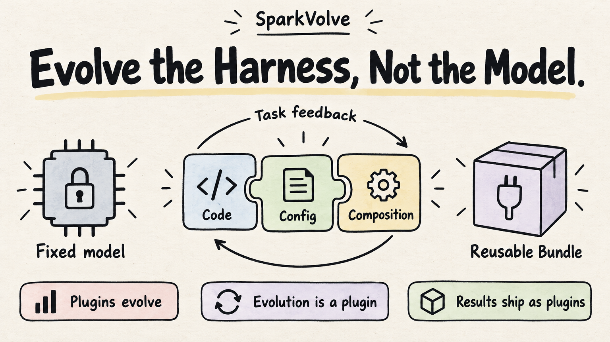
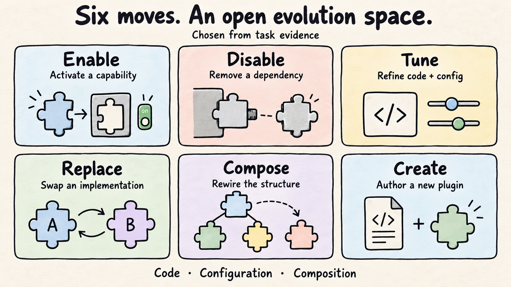
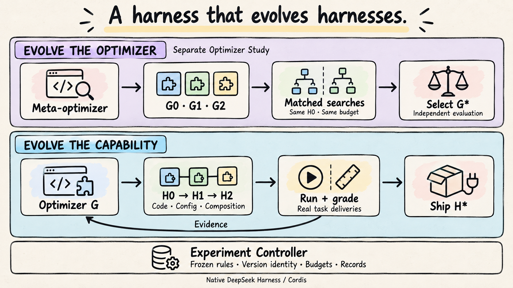
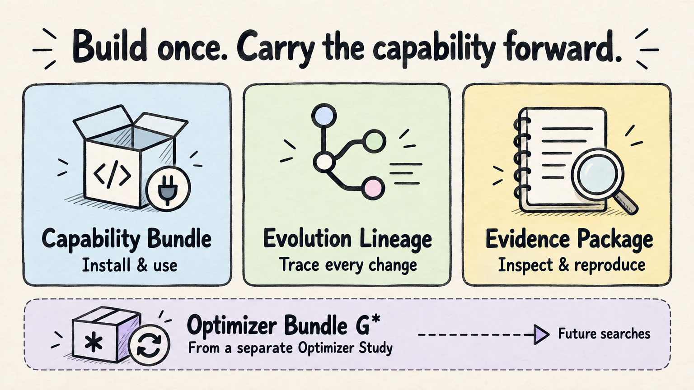
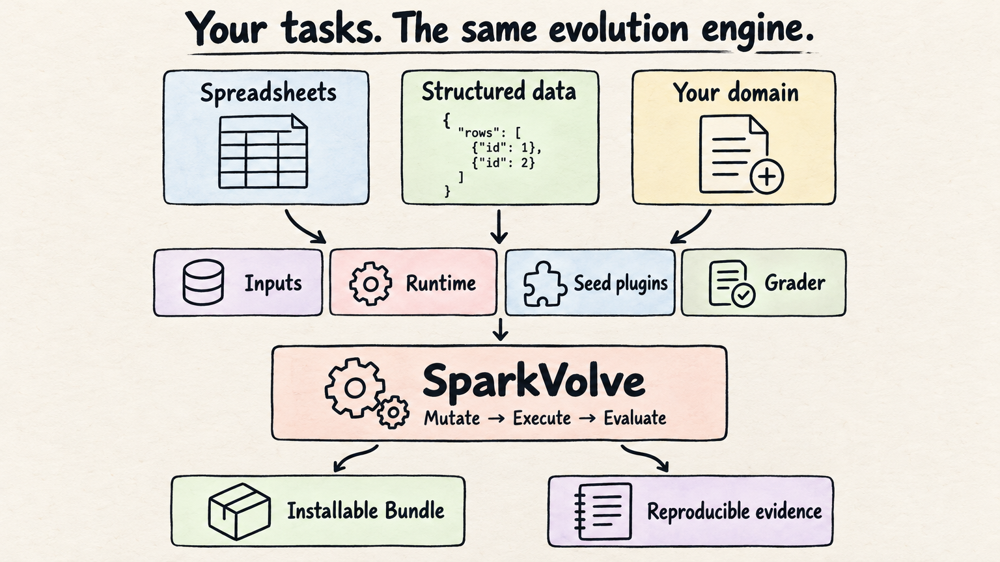

<div align="center">


# SparkVolve

**Evolve the Harness, Not the Model.**

不改模型权重，让 Harness 在任务中持续进化。

**让能力进化，让进化方法进化，让成果成为可安装的插件。**

[](https://github.com/OLDyade/SparkVolve/actions/workflows/verify.yml) [](LICENSE) [](docs/components.md)

[English](README.md) · [中文](README.zh-CN.md) · **[在线体验 ↗](https://oldyade.github.io/SparkVolve/)** · [快速开始](#quick-start) · [项目全景](11.md)

</div>

一个基于插件化架构的 Harness 自进化框架，让 Agent 通过真实任务反馈，自主改造自己的能力结构，并将有效改进沉淀为可复用的插件。

> 过去我们给 Agent 装能力，现在让 Agent 自己决定需要什么能力、修改什么能力，甚至创造新能力。



## 🧬 三个核心设计

| 插件即进化基因 | 进化也是插件 | 进化成果也是插件 |
|:---|:---|:---|
| **让 Harness 从“人工装配”走向“自主重构”**<br>插件代码、配置与组合结构，统一纳入进化空间。 | **给已有 Harness 装上自进化能力**<br>研究、编码与实验，运行在 DSH / Cordis 原生生态中。 | **从实验分数到可安装的能力**<br>Bundle、进化谱系与实验证据，让有效改进被复用。 |

**启用 · 停用 · 调优 · 替换 · 组合 · 创造**



<details>
<summary>核心思想原文</summary>

# 让 Harness 自己进化

## Evolve the Harness, Not the Model.

不改模型权重，让 Harness 在任务中持续进化。

**一句话定位：** 一个基于插件化架构的 Harness 自进化框架，让 Agent 通过真实任务反馈，自主改造自己的能力结构，并将有效改进沉淀为可复用的插件。

核心记忆点不是“Agent 越用越聪明”，而是：

> 过去我们给 Agent 装能力，现在让 Agent 自己决定需要什么能力、修改什么能力，甚至创造新能力。

## 三个核心设计

### 1. 插件即进化基因：让 Harness 从“人工装配”走向“自主重构”

不再局限于 Prompt、Skills 优化，而是把插件的配置、代码实现、组合拓扑统一作为进化对象。

能启停、能调参、能替换、能重组，还能创造新的插件。

这是最值得投入研究的技术创新点。

### 2. 进化也是插件：给已有 Harness 装上自进化能力

不需要重新造一套 Agent Runtime。基于 DSH 原生插件体系，将优化器、实验控制、执行验证等能力装配到现有环境。

不是创造一个会进化的 Agent，而是让已有的 Harness 具备进化能力。

这是非常适合开源生态传播的产品创新点。

### 3. 进化成果也是插件：从实验分数到可安装的能力

自主发现问题、修改插件、验证收益，最后不只得到一个更高的 Benchmark 分数，还输出可安装的 Bundle、候选谱系与复现实验。

让一次进化的收益，成为其他开发者可直接复用的能力。

这是区别于仅展示优化曲线的研究原型的交付创新点。

</details>

## 🔁 用 Harness 进化 Harness

**执行器可以进化自己的能力，优化器也可以进化自己的方法。**



| 进化对象 | 改变什么 | 如何选择 |
|:---|:---|:---|
| **H · 执行器 Harness** | 业务工具、插件代码、配置与装配结构 | 独立评分真实任务交付 |
| **G · 优化器 Harness** | 研究问题、开发插件、开展实验的方法 | 从相同 H0、相同预算上限出发，比较其产出的 H |

**Discover → Adapt / Author → Compose → Evaluate → Ship**

| 🔎 发现能力 | 🧩 组合进化 | 📦 交付成果 |
|:---|:---|:---|
| DSH 官方、社区市场、本地 Bundle 与研究资产 | 精确依赖、原生装配层及实际 Cordis 服务绑定 | 经过评测的原始能力包、真实谱系与独立验证 |

优化器自主选择复用、改造或创造。冻结能力目录让选择可追溯，原生依赖解析把选择变成可继续进化的候选。[查看能力进化全链路 →](docs/capability-evolution.md)

两者共用 **DeepSeek Harness / Cordis** 底座。Controller 管理实验规则、版本、预算与记录，Grader 评估交付。优化器自身的进化通过独立 **Optimizer Study** 开展。

[原生插件开发](docs/native-authoring.md) · [行为实验台](docs/behavioral-probes.md) · [优化器进化](docs/optimizer-studies.md) · [完整架构](docs/architecture.md)

## 📦 把进化成果带走

**可安装，可追溯，可复用。**



| 交付物 | 包含什么 | 如何使用 |
|:---|:---|:---|
| **Capability Bundle · H\*** | 原始 `bundle.tgz`、源码、装配配置与能力卡 | [安装到新 DSH Profile](docs/use-capability.md) |
| **Evolution Lineage · 进化谱系** | 候选关系、源码差异、变异提案与选择记录 | [追溯真实改造过程](docs/experiments/anatomy-of-a-mutation.md) |
| **Evidence Package · 实验证据** | 分数、失败、用量、轨迹索引与独立验证 | [审计与复现实验](docs/experiments/README.md) |
| **Optimizer Bundle · G\*** | **独立研究**选出的优化器源码与冻结产物 | [复用进化方法](docs/optimizer-studies.md) |

能力安装后直接在原生 Agent Loop 中运行，使用时无需再跑一遍进化流程。

<a id="quick-start"></a>

## 🚀 开始进化

| 先看真实实验 | 启动自己的实验 |
|:---|:---|
| **[打开交互式导览 ↗](https://oldyade.github.io/SparkVolve/)**<br>源码差异、逐题结果、可下载记录。无需安装或调用模型。 | **[准备环境](docs/quick-start.md#preparation)**<br>克隆仓库；Node.js 24、Python 3、Docker、官方 DeepSeek 密钥及预留私有网段。 |

```bash
npm ci
npm start -- --env-file /absolute/private/deepseek.env
```

**一个入口：自主开发 → 独立验证 → 原包安装 → 新任务复用。** 默认官方 DeepSeek、结构化数据任务、每题 **600 秒**。凭证保存在仓库外；首次启动构建镜像，模型调用消耗供应商额度。

**带上你的领域：** 🗂 任务 + ⚙️ 运行环境 + 🧩 种子插件 + ⚖️ 评分器。



通过 `--recipe` 选择任务配置，新领域需实现并验证适配器。[结构化数据](docs/structured-data.md)与 [Excel](examples/spreadsheet)都是示例。运行时原生接入 DSH / Cordis。

[完整快速开始](docs/quick-start.md) · [接入新领域](docs/domain-adapters.md) · [安装能力包](docs/use-capability.md)

## 📊 从自主改代码，到能力交付

一轮真实官方 DeepSeek 实验，为读写插件新增了 **`workbook_recalculate`**，接入 LibreOffice 计算；下一候选继续完善工具说明。

| 自主开发搜索 | 独立验证 | 原包安装复用 |
|:---:|:---:|:---:|
| **56.25% → 81.25% → 100%** | **81.25% → 100%** | **4 / 4 任务通过** |
| H0 → H1 → H2 | 重新执行 H0 与 H2 | 原始归档，全新 Profile |

**[查看真实源码差异 →](docs/experiments/anatomy-of-a-mutation.md)** · [在线查看各阶段](https://oldyade.github.io/SparkVolve/#experiment)

以上为合成任务实测。稳定收益、跨领域迁移及优化器优越性，仍是待验证的研究问题。

<details>
<summary><strong>实验账本：成果、退步与剩余工作</strong></summary>

| 实验 | 已有证据 |
|:---|:---|
| [执行器进化](docs/experiments/2026-10-28-official-deepseek-results.md) | 真实插件实现变更、独立验证、原包复用；本例未改变插件拓扑。 |
| [优化器进化](docs/experiments/2026-10-28-optimizer-study-results.md) | G1 已自主生成、构建并运行；与 G0 打平，保留 G0。新增工具的原生调用次数为零。 |
| [插件变异方法对照](docs/experiments/2026-10-29-closure-study-results.md) | 三组、六次搜索、十二份改动、124 次任务评分。五次保留 H0，一份候选独立验证与复用均为 100%；尚未证明方法优势。 |
| [单命令启动](docs/experiments/2026-10-29-official-closure-results.md) | 结构化数据搜索、独立验证与原包复用全部完成；保留 H0。 |

原生依赖组合与真实社区包采用已完成行为验收，包括原包安装复用。自主结构进化与稳定提分仍需更充分的研究证据。[能力集成验收](docs/experiments/2026-10-30-capability-evolution.md)。[实现状态](docs/completion.md) · [全部实验](docs/experiments/README.md) · [研究协议](docs/research-protocol.md)

</details>

## 🧭 在 SparkVolve 上继续创造

| 理解方法 | 扩展能力 | 开展研究 | 交付成果 |
|:---|:---|:---|:---|
| [项目全景](11.md)<br>[系统架构](docs/architecture.md)<br>[组件机制](docs/components.md) | [用户旅程](docs/user-journey.md)<br>[领域适配](docs/domain-adapters.md)<br>[兼容环境](docs/compatibility.md) | [实验协议](docs/research-protocol.md)<br>[优化器研究](docs/optimizer-studies.md)<br>[证据索引](docs/experiments/README.md) | [安装 Bundle](docs/use-capability.md)<br>[发布指南](docs/releasing.md)<br>[参与贡献](CONTRIBUTING.md) |

带来一个新领域、一种变异方法，或一份可复现的失败案例。[参与贡献](CONTRIBUTING.md) · [提交 Issue](https://github.com/OLDyade/SparkVolve/issues) · [安全说明](SECURITY.md)

---

基于 **DeepSeek Harness / Cordis** 原生插件生态。[Apache-2.0](LICENSE) · [第三方归属](NOTICE) · [研究引用](CITATION.cff)。当前为开发版本，注册表与版本 Release 单独发布。
