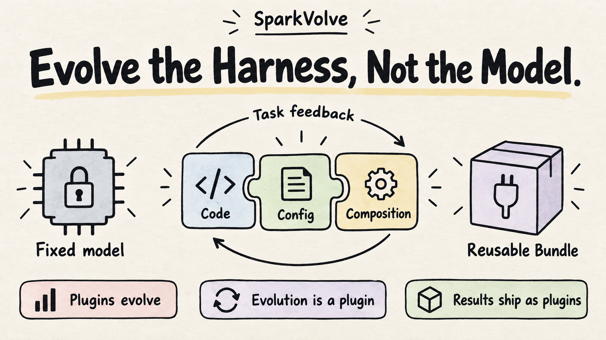
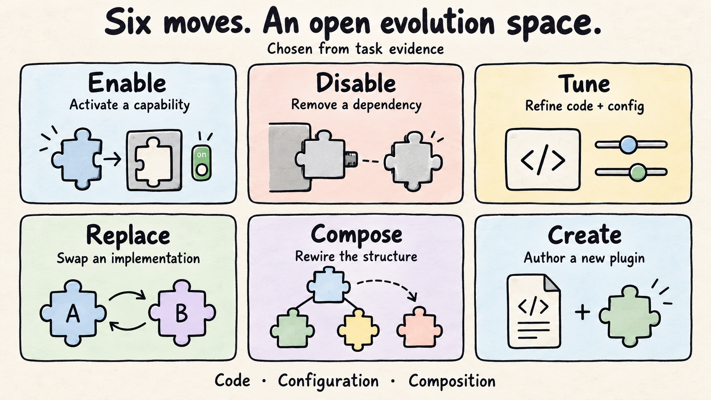
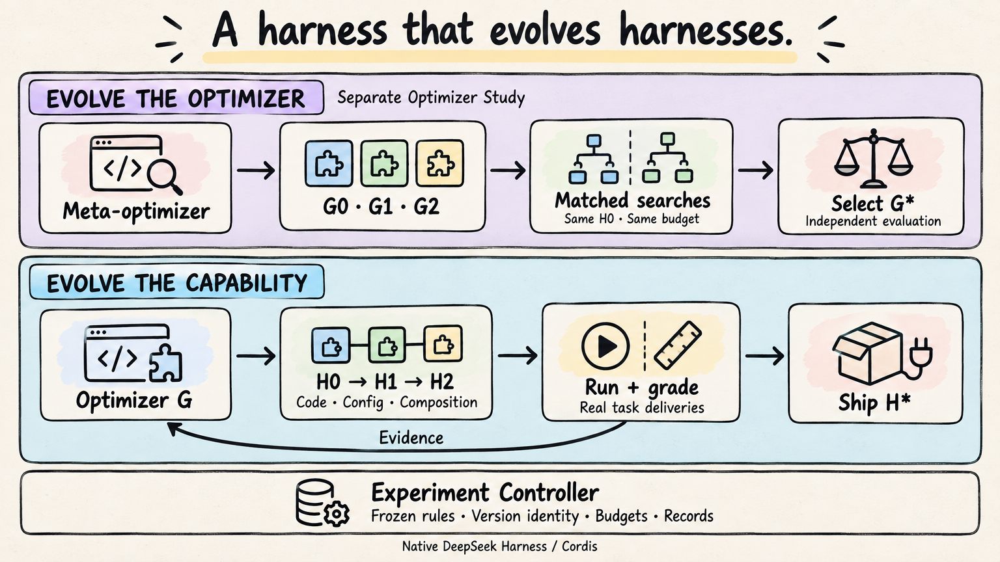
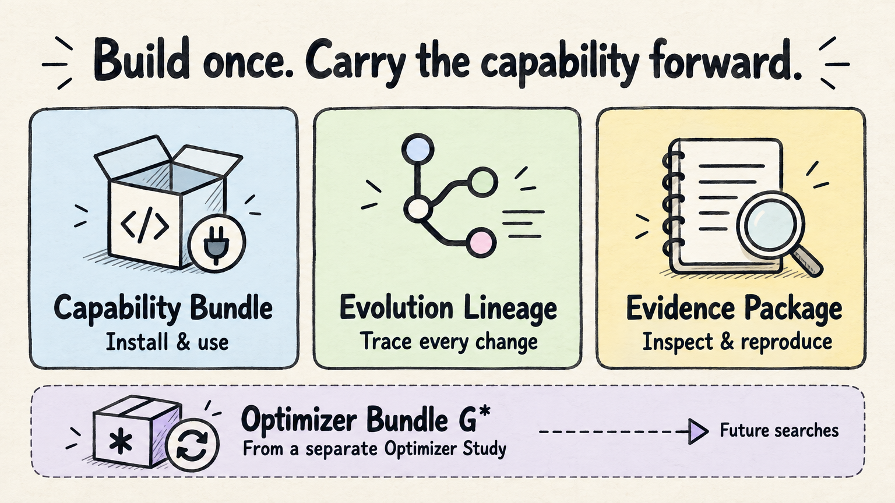
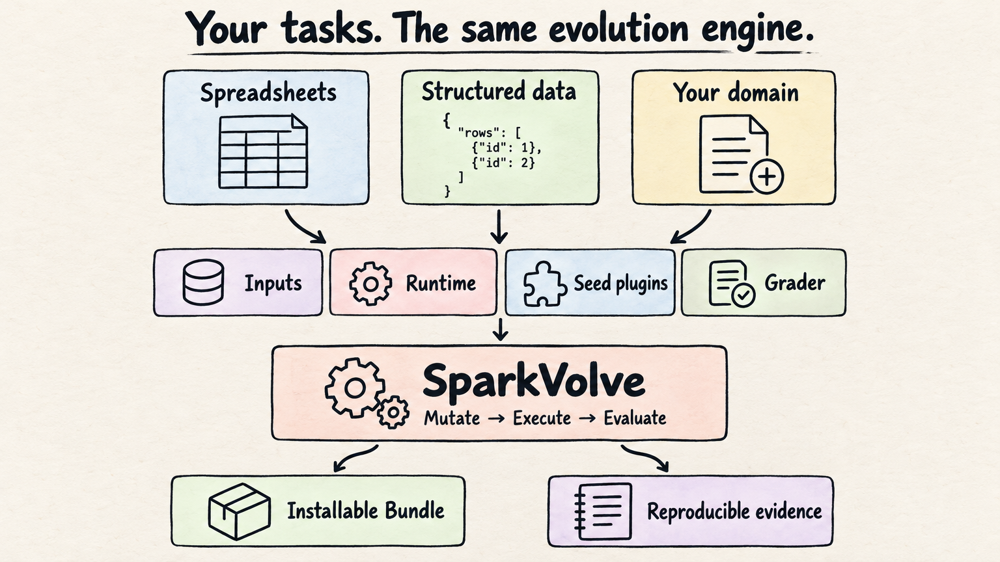

<div align="center">


# SparkVolve

**Evolve the Harness, Not the Model.**

不改模型权重，让 Harness 在任务中持续进化。

**让能力进化，让进化方法进化，让成果成为可安装的插件。**

> 🏆 **BIRD Mini-Dev 2026 · 官方 500 题全量 · EX 91.0%（455/500）** — 同一个模型，零权重更新，Harness 自己进化。

[](https://github.com/OLDyade/SparkVolve/actions/workflows/verify.yml) [](LICENSE) [](docs/components.md)

[English](README.md) · [中文](README.zh-CN.md) · **[在线体验 ↗](https://oldyade.github.io/SparkVolve/)** · [快速开始](#quick-start) · [项目全景](11.md)

</div>

一个基于插件化架构的 Harness 自进化框架，让 Agent 通过真实任务反馈，自主改造自己的能力结构，并将有效改进沉淀为可复用的插件。

> 过去我们给 Agent 装能力，现在让 Agent 自己决定需要什么能力、修改什么能力，甚至创造新能力。



## 🧬 三个核心设计

| 插件即进化基因 | 进化也是插件 | 进化成果也是插件 |
|:---|:---|:---|
| **让 Harness 从“人工装配”走向“自主重构”**<br>插件代码、配置与组合结构，统一纳入进化空间。 | **给已有 Harness 装上自进化能力**<br>研究、编码与实验，运行在 DSH / Cordis 原生生态中。 | **从实验分数到可安装的能力**<br>Bundle、进化谱系与实验证据，让有效改进被复用。 |

**启用 · 停用 · 调优 · 替换 · 组合 · 创造**



<details>
<summary>核心思想原文</summary>

# 让 Harness 自己进化

## Evolve the Harness, Not the Model.

不改模型权重，让 Harness 在任务中持续进化。

**一句话定位：** 一个基于插件化架构的 Harness 自进化框架，让 Agent 通过真实任务反馈，自主改造自己的能力结构，并将有效改进沉淀为可复用的插件。

核心记忆点不是“Agent 越用越聪明”，而是：

> 过去我们给 Agent 装能力，现在让 Agent 自己决定需要什么能力、修改什么能力，甚至创造新能力。

## 三个核心设计

### 1. 插件即进化基因：让 Harness 从“人工装配”走向“自主重构”

不再局限于 Prompt、Skills 优化，而是把插件的配置、代码实现、组合拓扑统一作为进化对象。

能启停、能调参、能替换、能重组，还能创造新的插件。

这是最值得投入研究的技术创新点。

### 2. 进化也是插件：给已有 Harness 装上自进化能力

不需要重新造一套 Agent Runtime。基于 DSH 原生插件体系，将优化器、实验控制、执行验证等能力装配到现有环境。

不是创造一个会进化的 Agent，而是让已有的 Harness 具备进化能力。

这是非常适合开源生态传播的产品创新点。

### 3. 进化成果也是插件：从实验分数到可安装的能力

自主发现问题、修改插件、验证收益，最后不只得到一个更高的 Benchmark 分数，还输出可安装的 Bundle、候选谱系与复现实验。

让一次进化的收益，成为其他开发者可直接复用的能力。

这是区别于仅展示优化曲线的研究原型的交付创新点。

</details>

## 🔁 用 Harness 进化 Harness

**执行器可以进化自己的能力，优化器也可以进化自己的方法。**



| 进化对象 | 改变什么 | 如何选择 |
|:---|:---|:---|
| **H · 执行器 Harness** | 业务工具、插件代码、配置与装配结构 | 独立评分真实任务交付 |
| **G · 优化器 Harness** | 研究问题、开发插件、开展实验的方法 | 从相同 H0、相同预算上限出发，比较其产出的 H |

**Discover → Adapt / Author → Compose → Evaluate → Ship**

| 🔎 发现能力 | 🧩 组合进化 | 📦 交付成果 |
|:---|:---|:---|
| DSH 官方、社区市场、本地 Bundle 与研究资产 | 精确依赖、原生装配层及实际 Cordis 服务绑定 | 经过评测的原始能力包、真实谱系与独立验证 |

优化器自主选择复用、改造或创造。冻结能力目录让选择可追溯，原生依赖解析把选择变成可继续进化的候选。[查看能力进化全链路 →](docs/capability-evolution.md)

两者共用 **DeepSeek Harness / Cordis** 底座。Controller 管理实验规则、版本、预算与记录，Grader 评估交付。优化器自身的进化通过独立 **Optimizer Study** 开展。

[原生插件开发](docs/native-authoring.md) · [行为实验台](docs/behavioral-probes.md) · [优化器进化](docs/optimizer-studies.md) · [完整架构](docs/architecture.md)

## 📦 把进化成果带走

**可安装，可追溯，可复用。**



| 交付物 | 包含什么 | 如何使用 |
|:---|:---|:---|
| **Capability Bundle · H\*** | 原始 `bundle.tgz`、源码、装配配置与能力卡 | [安装到新 DSH Profile](docs/use-capability.md) |
| **Evolution Lineage · 进化谱系** | 候选关系、源码差异、变异提案与选择记录 | [追溯真实改造过程](docs/experiments/anatomy-of-a-mutation.md) |
| **Evidence Package · 实验证据** | 分数、失败、用量、轨迹索引与独立验证 | [审计与复现实验](docs/experiments/README.md) |
| **Optimizer Bundle · G\*** | **独立研究**选出的优化器源码与冻结产物 | [复用进化方法](docs/optimizer-studies.md) |

能力安装后直接在原生 Agent Loop 中运行，使用时无需再跑一遍进化流程。

<a id="quick-start"></a>

## 🚀 开始进化

| 先看真实实验 | 启动自己的实验 |
|:---|:---|
| **[打开交互式导览 ↗](https://oldyade.github.io/SparkVolve/)**<br>源码差异、逐题结果、可下载记录。无需安装或调用模型。 | **[准备环境](docs/quick-start.md#preparation)**<br>克隆仓库；Node.js 24、Python 3、Docker、官方 DeepSeek 密钥及预留私有网段。 |

```bash
npm ci
npm start -- --env-file /absolute/private/deepseek.env
```

**一个入口：自主开发 → 独立验证 → 原包安装 → 新任务复用。** 默认官方 DeepSeek、**SpreadsheetBench 2 的 36 题分组子集**、每题 **900 秒**。凭证保存在仓库外；首次启动构建镜像，模型调用消耗供应商额度。

**带上你的领域：** 🗂 任务 + ⚙️ 运行环境 + 🧩 种子插件 + ⚖️ 评分器。



通过 `--benchmark` 选择社区评测适配器。[SpreadsheetBench 2 专项](benchmarks/spreadsheetbench2/README.md)将官方任务与评分接入同一套 DSH / Cordis 进化引擎。

[完整快速开始](docs/quick-start.md) · [接入新领域](docs/domain-adapters.md) · [安装能力包](docs/use-capability.md)

## 📊 实测：BIRD Mini-Dev 2026

**同一个模型，零权重更新，Harness 自己进化出来的 Text-to-SQL 能力。**

| 版本 | 评测 | SQLite EX |
|:---|:---|:---:|
| 起点 H0 · 交互式 agent | 开发集 | 76.1% |
| **进化冠军 H49** | **开发集 · 300 题** | **91.67%（275/300）** |
| **进化冠军 H49** | **验证集 · 100 题（未参与进化）** | **89%（89/100）** |
| **进化冠军 H49** | **测试集 · 100 题（未参与进化）** | **91%（91/100）** |
| **进化冠军 H49** | **官方 500 题全量** | **91.0%（455/500）** |

官方 500 题按 300 开发 / 100 验证 / 100 测试划分。三个集合成绩一致，未参与进化的 200 题同样保持 90% 水平。

- 🧬 **58 代候选、9 次冠军跃迁**：每一代都保留真实 parent 谱系，退步版本同样公开。
- 🔁 **优化器也在进化**：G 在搜索中改写自己 20 次，17 个版本通过原生加载并投入实际搜索。
- 🔍 **改出来的能力人能读懂**：冠军进化出 23 条 SQL 推理纪律，例如先建群体再算比例、否定条件会吞掉 NULL、"最新"修饰的名词决定排序对象。没有任何题目特判。
- ⚙️ 固定 DeepSeek V4 Flash，每题 300 秒，官方 `calculate_ex` 评分器原样执行。

> 参照：官方固定 prompt 榜单（单次生成、不可查库）上，DeepSeek V4.1-Flash 为 61.0%，Claude Opus 5.5 为 90.0%。SparkVolve 采用可查库的交互式 agent 设定。

**[结果与产物 →](releases/bird-mini-dev-2026/README.md)** · 数据来源 [`birdsql/bird_mini_dev`](https://huggingface.co/datasets/birdsql/bird_mini_dev)（CC BY-SA 4.0）

### 📦 开源产物

| | 内容 |
|:---|:---|
| **H49 执行插件** | 进化后的源码、配置、锁文件和安装包，直接安装使用 |
| **G 优化器插件** | 跑出 H49 的优化器源码、策略与配置，可继续探索 |

**[下载与安装 →](releases/bird-mini-dev-2026/README.md)**

## 🧭 在 SparkVolve 上继续创造

| 理解方法 | 扩展能力 | 开展研究 | 交付成果 |
|:---|:---|:---|:---|
| [项目全景](11.md)<br>[系统架构](docs/architecture.md)<br>[组件机制](docs/components.md) | [用户旅程](docs/user-journey.md)<br>[领域适配](docs/domain-adapters.md)<br>[兼容环境](docs/compatibility.md) | [实验协议](docs/research-protocol.md)<br>[优化器研究](docs/optimizer-studies.md)<br>[证据索引](docs/experiments/README.md) | [安装 Bundle](docs/use-capability.md)<br>[发布指南](docs/releasing.md)<br>[参与贡献](CONTRIBUTING.md) |

带来一个新领域、一种变异方法，或一份可复现的失败案例。[参与贡献](CONTRIBUTING.md) · [提交 Issue](https://github.com/OLDyade/SparkVolve/issues) · [安全说明](SECURITY.md)

---

基于 **DeepSeek Harness / Cordis** 原生插件生态。[Apache-2.0](LICENSE) · [第三方归属](NOTICE) · [研究引用](CITATION.cff)。当前为开发版本，注册表与版本 Release 单独发布。
