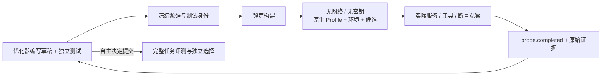

# 原生行为实验台

让优化器把机制假设变成可执行实验：测试插件的工具、服务和组合关系，再根据观察选择改动。实验台沿用 DSH 原生装配和工具执行，新增的只有实验身份、隔离调度与证据入口。



## 使用协议

研究者在新实验合同中显式声明 `probes: { "limit": 6, "timeoutSeconds": 120 }`；`null` 表示不授权。`validation` 必须为 `null`。成功、业务断言失败、构建及运行失败都消耗一次登记额度，候选预算和评分保持独立。构建另受 `candidate.build.timeoutSeconds` 约束。

优化器用原生文件工具准备两份目录：插件草稿 `/workspace/my-draft` 和测试 `/workspace/my-suite`。调用：

```json
{
  "draft": "my-draft",
  "suite": "my-suite",
  "entry": "check.mjs",
  "hypothesis": "状态更新后的服务输出应反映新值；旧消费者不能缓存旧结果"
}
```

这段参数交给 `evolution_probe`。返回实验 ID 后使用已有 `evolution_wait` 游标协议，收到 `probe.completed` 再读取 `evolution_probe_evidence`。后者支持 `source / suite / build / artifact / logs / observations`，省略 `file` 返回清单，文件以 base64 返回。

`suite` 必须是目录；`entry` 是该目录下真实存在的模块文件，例如 `checks/probe.mjs`，不能附加 `#probe`。目录及入口类型在创建实验前检查，输入错误直接返回，不消耗登记额度。`call()` 返回原生对象，不能对整个结果执行 `JSON.parse`；只有工具明确约定 JSON 文本时才解析相应 `content` 文本块。

测试模块导出 `async probe({ agent, ctx, call, workspace })`：

| 接口 | 实际行为 |
|---|---|
| `agent`、`ctx` | 本次原生创建的 Agent 及其 Context，可按 Cordis API 观察已装配服务 |
| `call(name, args)` | DSH `0.2.1-rc.4` 原生 `tools.execute`，传递实际 Agent 作用域，返回完整原生结果；工具错误保留为 `isError`，由测试明确断言 |
| `workspace` | 此次实验新建的可写目录；与优化器写草稿的目录不同 |
| 测试夹具 | `new URL('./rows.json', import.meta.url)` 访问同目录冻结文件 |

执行容器内，测试位于只读 `/suite`，构建后的插件位于只读 `/candidate`，`workspace` 为初始空目录 `/workspace`。作者目录下的子目录不会被复制到可写目录；需要输出子目录时由测试明确创建。模型提供商、任务输入、评测材料、控制令牌和 Docker socket 均不挂入。环境插件与 Profile 保留；若其初始化本身要求不可用的外部依赖，实验明确失败。

```js
import assert from 'node:assert/strict';

export async function probe({ call }) {
  const forward = await call('number_distance', { a: 2, b: 5 });
  const reverse = await call('number_distance', { a: 5, b: 2 });
  assert.equal(forward.isError, false);
  assert.equal(reverse.isError, false);
  // 从距离定义推导对称性，避免把实现本身当作预期值来源。
  assert.equal(Number(reverse.content[0].text), Number(forward.content[0].text));
}
```

## 证据、恢复与边界

- 身份由源码、测试内容和入口共同决定。只修改假设文字不产生新实验；相同输入不重复运行。修改代码后可复用同一套测试对比。
- 准备意图先落盘；已完成的冻结快照在数据库登记前遇到中断，恢复时逐字节校验后继续登记。已登记实验中断后继续收集原命名构建/执行容器。
- 保存构建身份、完整装配审计、原生工具调用结果、断言异常、退出状态、耗时和原始日志。正常返回记为 `passed`，异常或非零退出记为 `failed`；均可作为后续变异证据。
- **通过只说明作者提供的测试通过。** 作者可以写错断言、遗漏边界，甚至提交空测试；它不提供独立正确性证明，不产生任务分数，也不成为提交或保存门槛。
- 执行禁网且不传密钥；构建按既有构建网络合同进行，可能访问依赖注册表。探针不启动模型轮次，作者编写测试所消耗的优化器模型调用照常计账。
- 一次实验的结论绑定其实际构建身份。正式提交会登记独立候选及构建；同源非确定性构建不保证同产物，不能把探针通过直接继承成正式验收。

设计来源、当前版本差异和未采纳机制见[调研记录](research/2026-10-28-executable-probes.md)。调用、成功/失败、断言反例及真实模型使用见同页验收记录；未以这些工程测试宣称提分。

后续 [64 次任务对照](experiments/2026-10-28-native-probe-spreadsheet-results.md) 保留负结果、空测试和接口误用；没有观察到开启组相对自身基线的收益。
