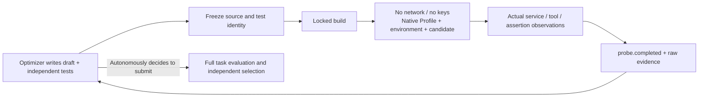

# Native Behavioral Probe Bench

Let the optimizer turn mechanism hypotheses into executable experiments: test the plugin's tools, services, and composition relationships, then choose changes based on observations. The probe bench reuses DSH native assembly and tool execution; the only additions are experiment identity, isolated scheduling, and an evidence entry point.



## Usage Protocol

The researcher explicitly declares `probes: { "limit": 6, "timeoutSeconds": 120 }` in the new experiment contract; `null` means not authorized. `validation` must be `null`. Success, business assertion failure, and build and run failures all consume one registration quota; the candidate budget and scoring remain independent. Builds are additionally constrained by `candidate.build.timeoutSeconds`.

The optimizer uses native file tools to prepare two directories: the plugin draft `/workspace/my-draft` and the tests `/workspace/my-suite`. Call:

```json
{
  "draft": "my-draft",
  "suite": "my-suite",
  "entry": "check.mjs",
  "hypothesis": "After a state update, service output should reflect the new value; old consumers must not cache stale results"
}
```

These parameters are passed to `evolution_probe`. After the experiment ID is returned, use the existing `evolution_wait` cursor protocol; upon receiving `probe.completed`, read `evolution_probe_evidence`. The latter supports `source / suite / build / artifact / logs / observations`; omitting `file` returns the manifest, and files are returned as base64.

`suite` must be a directory; `entry` is a module file that actually exists under that directory, for example `checks/probe.mjs`, and `#probe` cannot be appended. The directory and entry type are checked before the experiment is created; invalid input is returned directly and does not consume registration quota. `call()` returns a native object; `JSON.parse` must not be applied to the entire result; only when a tool explicitly specifies JSON text should the corresponding `content` text block be parsed.

The test module exports `async probe({ agent, ctx, call, observe, workspace })`:

| Interface | Actual behavior |
|---|---|
| `agent`, `ctx` | The Agent and its Context natively created for this run; assembled services can be observed via the Cordis API |
| `call(name, args)` | DSH `0.2.1-rc.4` native `tools.execute`, passing the actual Agent scope and returning the complete native result; tool errors are preserved as `isError` and explicitly asserted by the test |
| `await observe(label, value)` | Saves an explicitly named JSON value snapshot; used for service return values, dependency bindings, scopes, and cleanup state. Non-finite numbers, undefined, functions, and class instances raise an error directly; missing values must be explicitly expressed by the author, e.g. null |
| `workspace` | A writable directory newly created for this experiment; different from the directory where the optimizer writes drafts |
| Test fixtures | `new URL('./rows.json', import.meta.url)` accesses frozen files in the same directory |

Inside the execution container, tests are located in the read-only `/suite`, the built plugin is located in the read-only `/candidate`, and `workspace` is the initially empty directory `/workspace`. Subdirectories under the author directory are not copied to the writable directory; when output subdirectories are needed, the test must explicitly create them. Model providers, task inputs, evaluation materials, control tokens, and the Docker socket are not mounted. Environment plugins and Profiles are preserved; if their initialization itself requires unavailable external dependencies, the experiment explicitly fails.

```js
import assert from 'node:assert/strict';

export async function probe({ call }) {
  const forward = await call('number_distance', { a: 2, b: 5 });
  const reverse = await call('number_distance', { a: 5, b: 2 });
  assert.equal(forward.isError, false);
  assert.equal(reverse.isError, false);
  // Derive symmetry from the distance definition, avoiding using the implementation itself as the source of expected values.
  assert.equal(Number(reverse.content[0].text), Number(forward.content[0].text));
}
```

## Evidence, Recovery, and Boundaries

- Identity is determined jointly by the source, test content, and entry. Changing only the hypothesis text does not produce a new experiment; identical inputs are not run repeatedly. After modifying code, the same test suite can be reused for comparison.
- The preparation intent is persisted first; if a completed frozen snapshot is interrupted before database registration, recovery verifies it byte by byte and then continues registration. After a registered experiment is interrupted, collection of the originally named build/execution containers continues.
- Saves the build identity, full assembly audit, native tool call results, assertion exceptions, exit status, elapsed time, and raw logs. A normal return is recorded as `passed`, and an exception or non-zero exit is recorded as `failed`; both can serve as evidence for subsequent mutations.
- `observations` of `behavior.json` uses an incrementing sequence number and `kind: tool/value` to distinguish tool receipts from author observations. `observe` copies the value at call time, and tool receipts are recorded when execution returns; concurrent writes are persisted in order, and later modification of the original object does not change old evidence. Sparse arrays are rejected for recording, without filling or removing holes. All asynchronous calls should be awaited. Recording actual values first and then executing assertions preserves counterexamples when assertions fail. Observed values are still chosen by the test author and do not automatically prove that the service is correct, that coverage is complete, or that it is independent.
- **Passing only means that the tests provided by the author pass.** The author may write incorrect assertions, miss boundaries, or even submit empty tests; it does not provide an independent proof of correctness, does not produce a task score, and is not a threshold for submission or saving.
- Execution has network disabled and passes no keys; builds follow the existing build network contract and may access dependency registries. Probes do not start model rounds; optimizer model calls consumed by the author writing tests are still billed as usual.
- The conclusion of an experiment is bound to its actual build identity. Formal submission registers an independent candidate and build; non-deterministic builds from the same source do not guarantee the same artifact, and probe passes cannot be directly inherited as formal acceptance.

Design sources, differences from the current version, and mechanisms not adopted are in the [research notes](research/2026-10-28-executable-probes.md). Calls, successes/failures, assertion counterexamples, and real model usage are in the acceptance records on the same page; no score improvement is claimed based on these engineering tests.

The subsequent [64-task comparison](experiments/2026-10-28-native-probe-spreadsheet-results.md) preserves negative results, empty tests, and interface misuse; no benefit was observed for the enabled group relative to its own baseline.

[Service and scope observation acceptance](research/2026-10-28-service-observations.md) covers same-name service isolation, interface and configuration replacement, and asynchronous unloading; a real model called the new observation interface but chose the wrong property to expose the defect, the counterexample acceptance failed, and the raw evidence was fully preserved.
