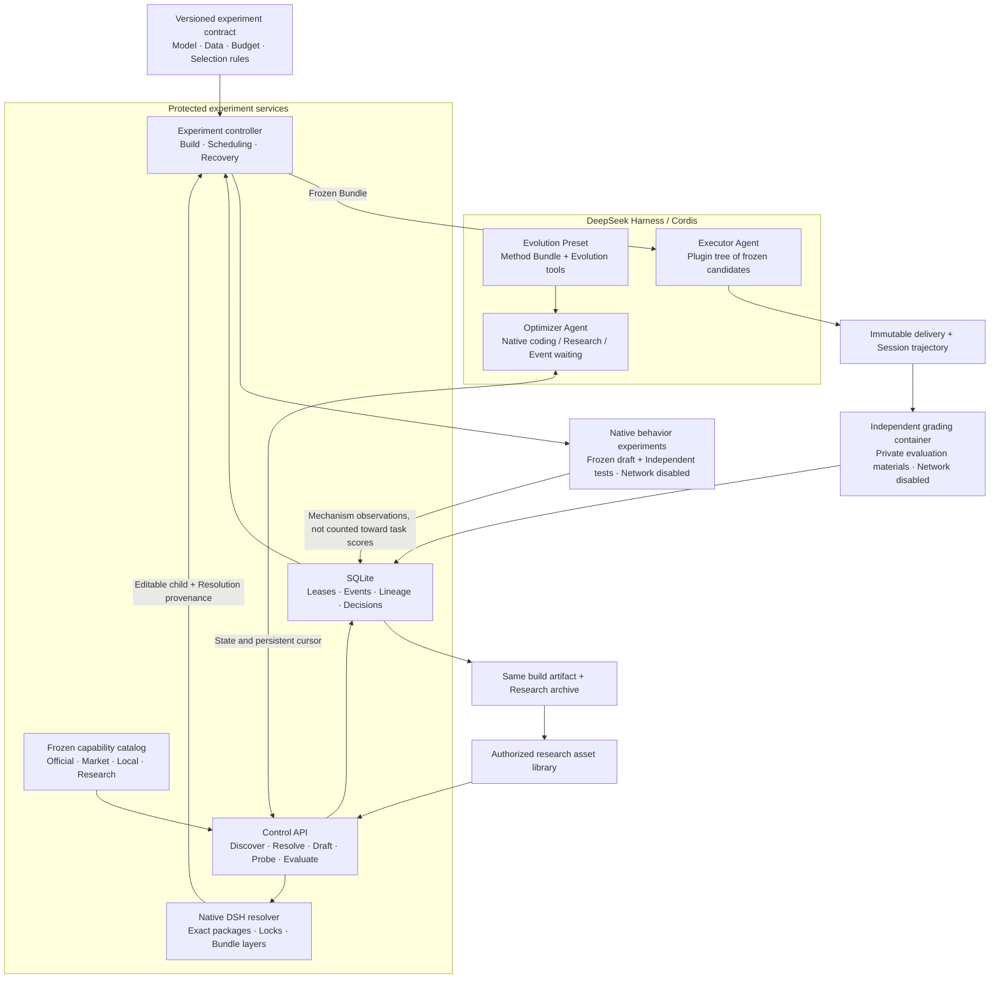
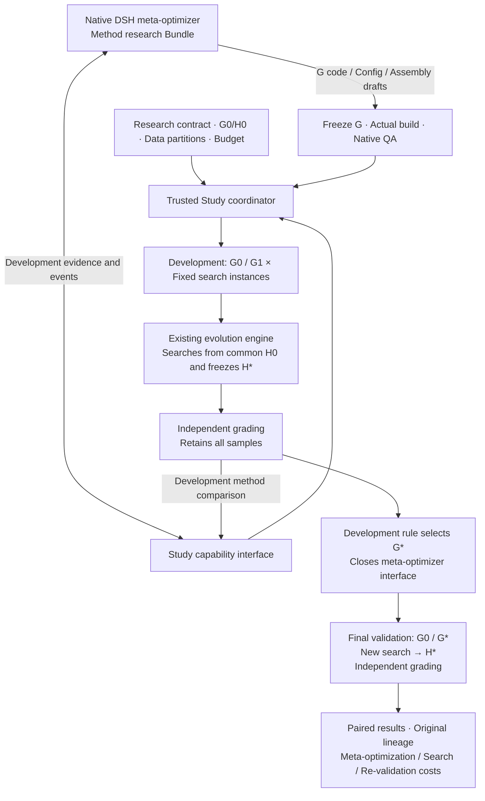
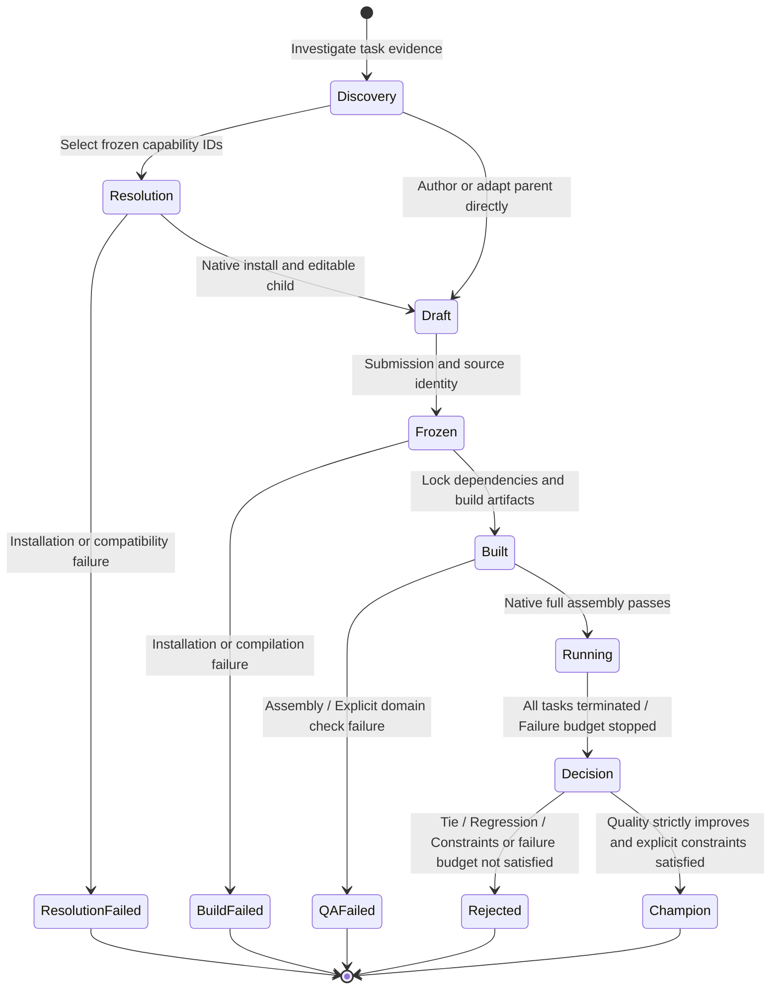

# Components and Lifecycle

This page describes the current implementation. The complete goals and core ideas are preserved in [`11.md`](../11.md), and unfinished capabilities are listed in [Delivery Status](completion.md).

## Native Composition and Experiment Boundaries



| Component | Responsibility | Implementation entry point |
|---|---|---|
| Evolution Bundle / Preset | Installs evolution tools and replaceable methods into the selected Agent scope | [`plugin.ts`](../src/plugin.ts), [`preset.ts`](../src/preset.ts), [`sdk-preset.ts`](../src/sdk-preset.ts) |
| Optimizer method | Selects parent version, mechanism, and mutation scope from evidence; can be versioned independently | [`optimizers/evidence-driven`](../optimizers/evidence-driven) |
| Native plugin development capability | Queries DSH author contracts and official Skills on demand; records installation sources; G observations and candidate H validation are kept separate | [`native-authoring.ts`](../src/native-authoring.ts), [Development Capability Assembly](native-authoring.md) |
| Capability discovery | Freezes authorized native catalogs, all market versions, local source and research archives; serves exact records | [`capabilities.ts`](../src/capabilities.ts), [Capability Evolution](capability-evolution.md) |
| Candidate resolution | Reserves an acquisition, installs through native DSH, vendors exact bytes and publishes an editable child | [`capability-resolution.ts`](../src/capability-resolution.ts), [`runtime/resolve-capabilities.ts`](../src/runtime/resolve-capabilities.ts) |
| Dependency-aware composition | Registers artifact dependencies in native Profiles; records observed Cordis bindings and actual source/assembly changes | [`bundle-profile.ts`](../src/bundle-profile.ts), [`harness-inventory.ts`](../src/harness-inventory.ts), [`mutation-evidence.ts`](../src/mutation-evidence.ts) |
| Optimizer research | Native meta-optimizer modifies G; trusted host schedules same-budget sub-searches and closed final validation | [`study-plugin.ts`](../src/study-plugin.ts), [`optimizer-study.ts`](../src/optimizer-study.ts), [Research Protocol](optimizer-studies.md) |
| Controller and state | Freezing, building, scheduling, resuming original containers, selection, and persistent events | [`controller.ts`](../src/controller.ts), [`store.ts`](../src/store.ts) |
| Build and assembly | lock pins dependencies; runtime artifacts are frozen; audits the complete native plugin tree | [`build.ts`](../src/build.ts), [`composition.ts`](../src/composition.ts) |
| Native behavior experiments | Autonomously writes mechanism tests; independent budget, freezing, and counterexample evidence | [`probes.ts`](../src/probes.ts), [Usage Protocol](behavioral-probes.md) |
| Execution and isolation | Native DSH sessions, explicit OCI runtime and permissions, request usage | [`runtime/worker.ts`](../src/runtime/worker.ts), [`docker.ts`](../src/docker.ts) |
| Evaluation and research | Independent grader, declared domain constraints, paired re-validation of fixed artifacts | [`constraints.ts`](../src/constraints.ts), [`validation.ts`](../src/validation.ts) |
| Delivery and reuse | Exports the original build package, saves provenance, imports new drafts for re-evaluation | [`export.ts`](../src/export.ts), [`library.ts`](../src/library.ts) |

## Two-Layer Closed Loop of Optimizer Research



The diagram above describes the extension mode already integrated into the code. [Real model research and original package installation](experiments/2026-10-28-optimizer-study-results.md) has been completed; development ties retain G0, and optimizer self-evolution gains have not been proven. Final validation has no return edge to the meta-optimizer; development quality, final quality, and engineering acceptance are recorded separately. Both native G session evidence and H task trajectories are readable; permissions are determined by the registered instance and execution identity.

## Lifecycle of a Candidate



Draft, Built, and Decision in the diagram denote operational phases; the candidate `phase` in the source is `frozen / build_failed / qa_failed / running / rejected / champion`. Task execution, grading, and re-grading are accounted separately; exports retain research records, and promotion does not trigger public release.

## Event-Driven Continuation

```mermaid
sequenceDiagram
  participant A as DSH Optimizer
  participant C as Control Service
  participant S as SQLite Event Ledger
  participant W as Execution and Grading Containers
  A->>C: Submit candidate
  C->>S: Freeze identity and submission event
  A->>C: status → cursor
  A->>C: evolution_wait(cursor)
  C->>W: Build, QA, execute, independent grading
  W-->>C: Actual delivery and exit status
  C->>S: Atomically commit results and events
  S-->>C: Wake waiters
  C-->>A: Event page + next cursor
  A->>C: Read raw evidence, select next mutation
  Note over C,W: After controller restart, collects original containers and preserves task identity
  Note over A,S: Event cursors are replayable; wait timeouts do not trigger task re-runs
```

Plugin start/stop, tuning, replacement, composition, and creation are selected by the optimizer based on evidence. Fixed contracts, independent evaluation, and content identity are enforced by the experiment layer. All roles share the DSH ecosystem, with runtime directories, permissions, and usage managed separately.
