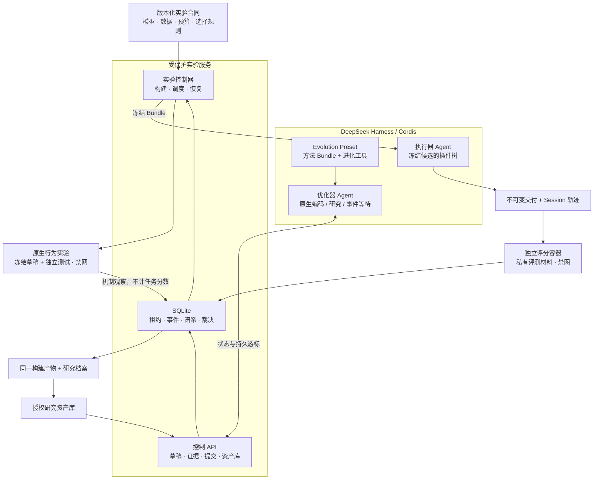
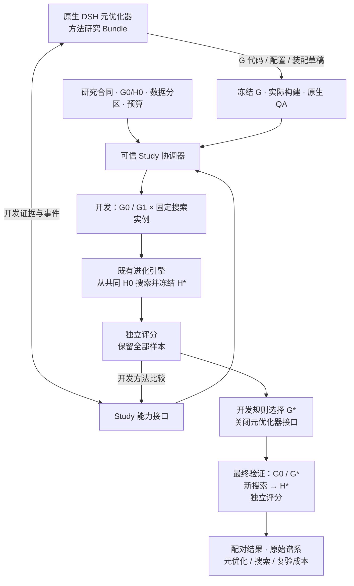
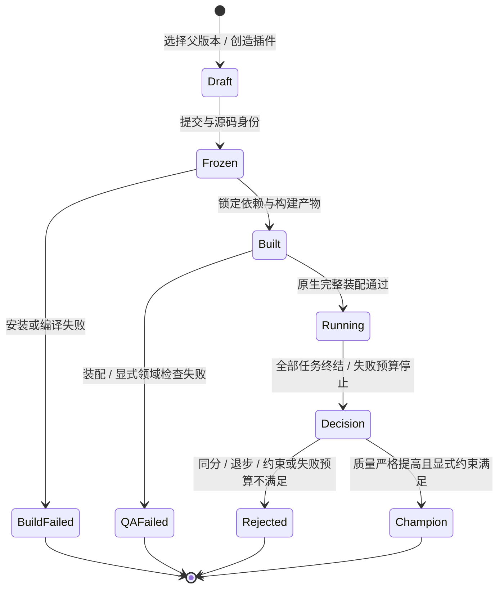
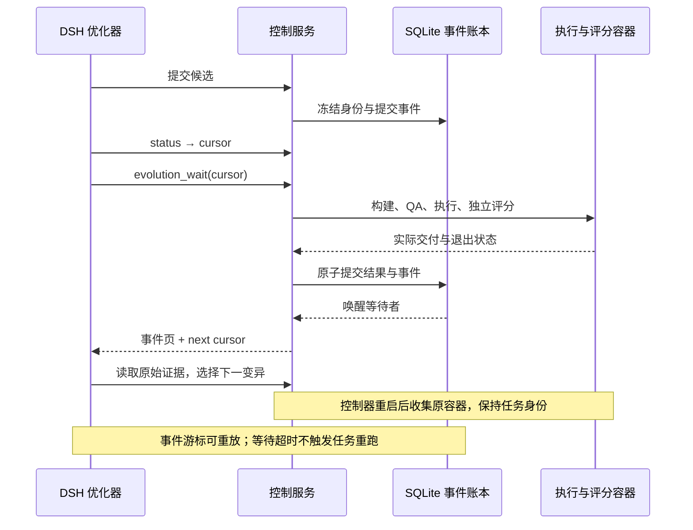

# 组件与生命周期

本页描述当前实现。完整目标与核心思想保留于 [`11.md`](../11.md)，未完成能力列于[交付状态](completion.md)。

## 原生组合与实验边界

| 组件 | 责任 | 实现入口 |
|---|---|---|
| 进化 Bundle / Preset | 将进化工具与可替换方法装入选定 Agent 作用域 | [`plugin.ts`](../src/plugin.ts)、[`preset.ts`](../src/preset.ts)、[`sdk-preset.ts`](../src/sdk-preset.ts) |
| 优化器方法 | 从证据选择父版本、机制和变异规模；可以独立版本化 | [`optimizers/evidence-driven`](../optimizers/evidence-driven) |
| 原生插件开发能力 | 按需查询 DSH 作者契约和官方 Skill；记录安装来源，G 观察与候选 H 的验证分开 | [`native-authoring.ts`](../src/native-authoring.ts)、[开发能力装配](native-authoring.md) |
| 优化器研究 | 原生元优化器修改 G，可信宿主调度同预算子搜索与封闭最终验证 | [`study-plugin.ts`](../src/study-plugin.ts)、[`optimizer-study.ts`](../src/optimizer-study.ts)、[研究协议](optimizer-studies.md) |
| 控制器与状态 | 冻结、构建、调度、续接原容器、选择与持久事件 | [`controller.ts`](../src/controller.ts)、[`store.ts`](../src/store.ts) |
| 构建与装配 | lock 固定依赖；运行产物冻结；审计完整原生插件树 | [`build.ts`](../src/build.ts)、[`composition.ts`](../src/composition.ts) |
| 原生行为实验 | 自主编写机制测试；独立预算、冻结与反例证据 | [`probes.ts`](../src/probes.ts)、[使用协议](behavioral-probes.md) |
| 执行与隔离 | 原生 DSH 会话、明确 OCI runtime 与权限、请求用量 | [`runtime/worker.ts`](../src/runtime/worker.ts)、[`docker.ts`](../src/docker.ts) |
| 评测与研究 | 独立 grader、声明的领域约束、固定产物配对复验 | [`constraints.ts`](../src/constraints.ts)、[`validation.ts`](../src/validation.ts) |
| 交付与复用 | 导出原构建包、保存来源、导入新草稿重新评测 | [`export.ts`](../src/export.ts)、[`library.ts`](../src/library.ts) |

## 优化器研究的两层闭环

上图描述已接入代码的扩展模式，[真实模型研究及原包安装](experiments/2026-10-28-optimizer-study-results.md)已经完成，开发同分保留 G0，未证明优化器自进化收益。最终验证没有返回元优化器的连线；开发质量、最终质量和工程验收分别记录。原生 G 会话证据与 H 任务轨迹均可读取，权限以注册实例和执行身份为准。

## 一个候选的生命周期

图中的 Draft、Built、Decision 表示操作阶段；源码中的候选 `phase` 是 `frozen / build_failed / qa_failed / running / rejected / champion`。任务执行、评分和重评分分别记账；导出保留研究记录，晋级不触发公开发布。

## 事件驱动接续

插件的启停、调优、替换、组合与创造由优化器依据证据选择。固定合同、独立评测和内容身份由实验层执行。各角色共用 DSH 生态，运行目录、权限与用量分别管理。
